# Claude Code Themes

Themes for the **Claude Code desktop app**: custom colors, and animated backdrops that play behind your conversation. Each theme is a small plugin you can install in one step, and this repository is also a kit for making your own.

## Themes

<!-- previews:start -->
|   |   |   |
| --- | --- | --- |
[<br>**abyss-lantern**](themes/abyss-lantern) | [<br>**arcade-hall**](themes/arcade-hall) | [<br>**aurora-field**](themes/aurora-field)
[<br>**beacon-cove**](themes/beacon-cove) | [<br>**code-rain**](themes/code-rain) | [<br>**colorblind-safe-dark**](themes/colorblind-safe-dark)
[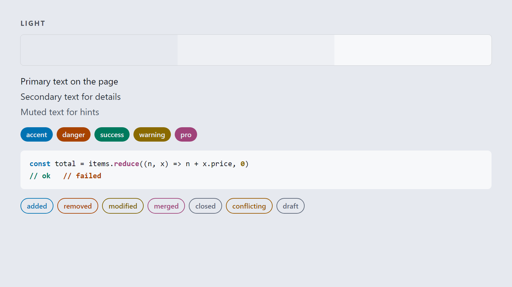<br>**colorblind-safe-light**](themes/colorblind-safe-light) | [<br>**contour-map**](themes/contour-map) | [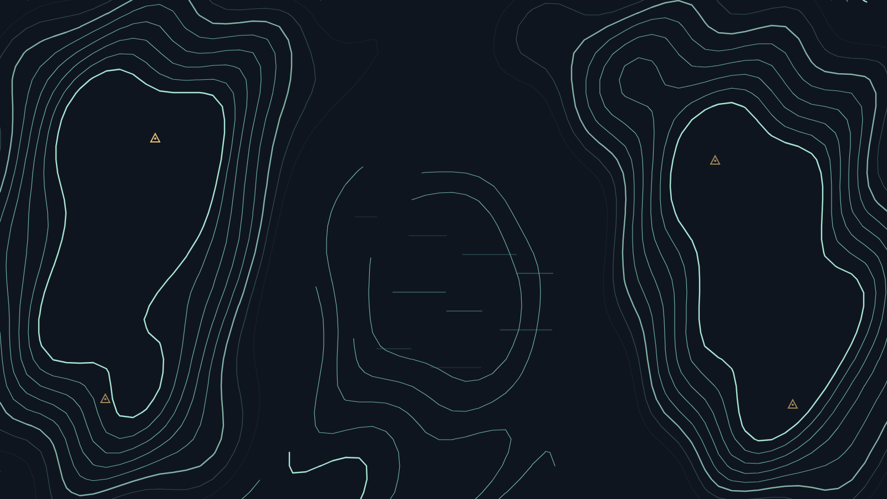<br>**contour-map-night**](themes/contour-map-night)
[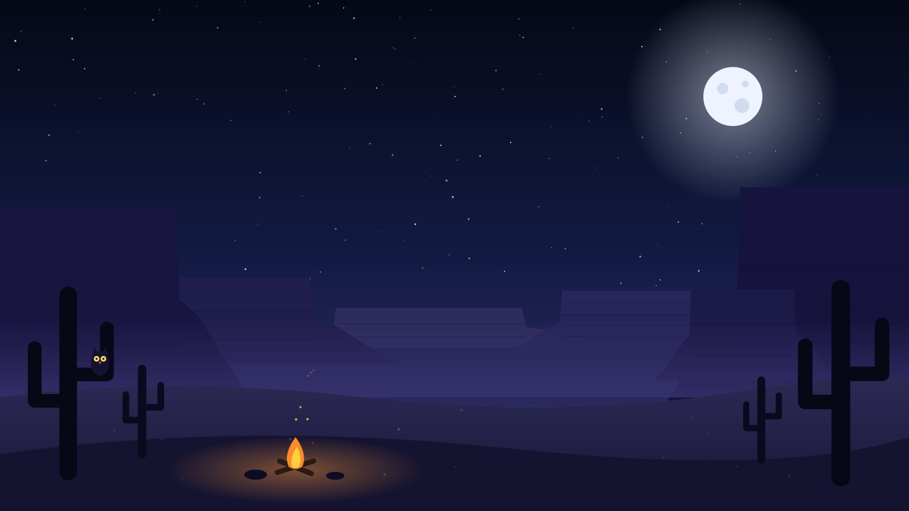<br>**desert-night**](themes/desert-night) | [<br>**desert-noon**](themes/desert-noon) | [<br>**fog-valley**](themes/fog-valley)
[<br>**fog-valley-night**](themes/fog-valley-night) | [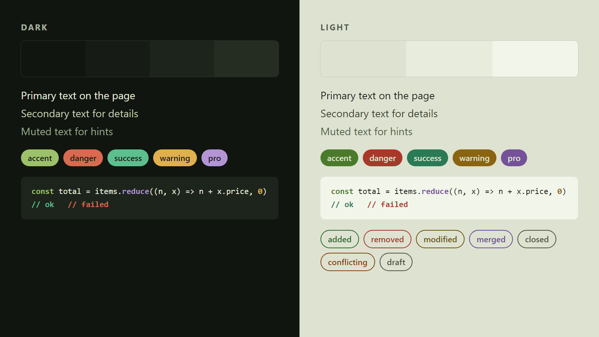<br>**forest-floor**](themes/forest-floor) | [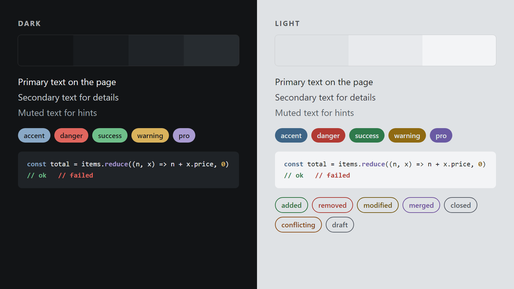<br>**graphite**](themes/graphite)
[<br>**halftone-harbor**](themes/halftone-harbor) | [<br>**halftone-harbor-night**](themes/halftone-harbor-night) | [<br>**hearth**](themes/hearth)
[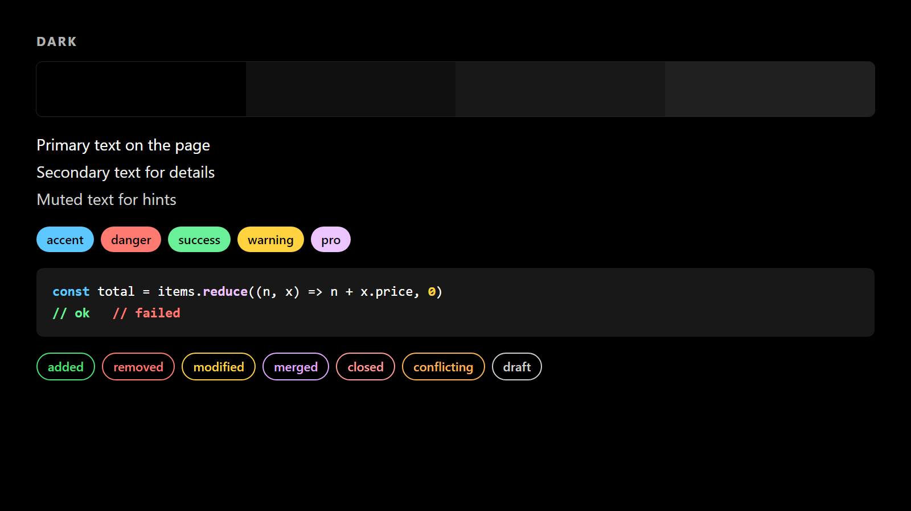<br>**high-contrast-dark**](themes/high-contrast-dark) | [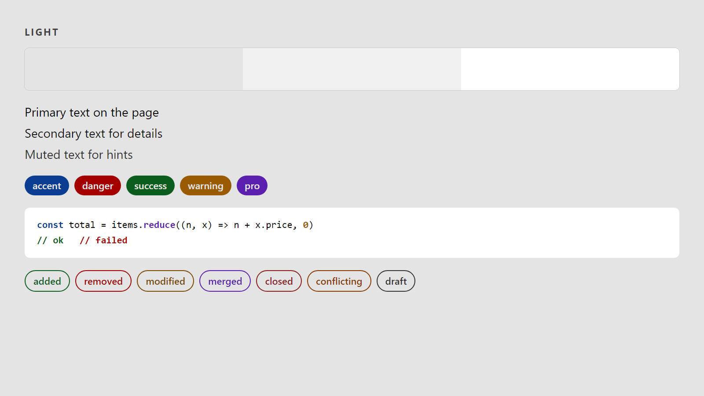<br>**high-contrast-light**](themes/high-contrast-light) | [<br>**low-orbit**](themes/low-orbit)
[<br>**meadow-hours**](themes/meadow-hours) | [<br>**midnight-ink**](themes/midnight-ink) | [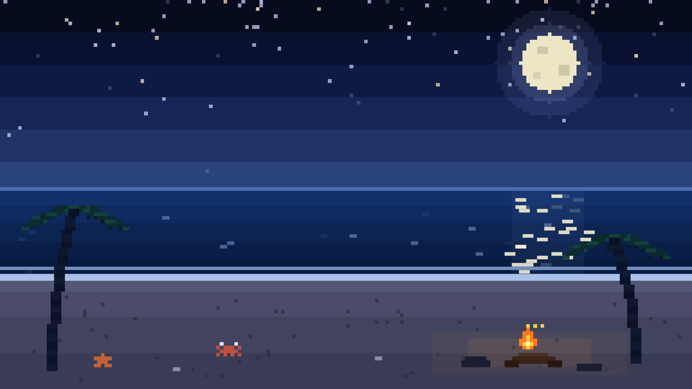<br>**moonlit-shore**](themes/moonlit-shore)
[<br>**neon-rain**](themes/neon-rain) | [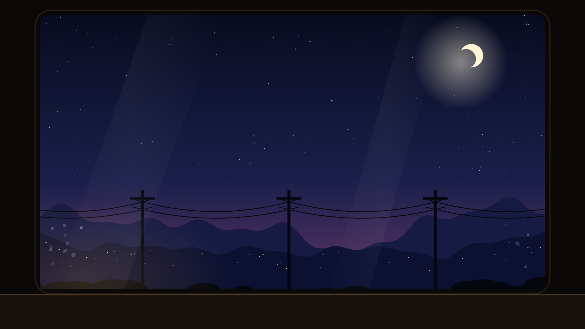<br>**night-train**](themes/night-train) | [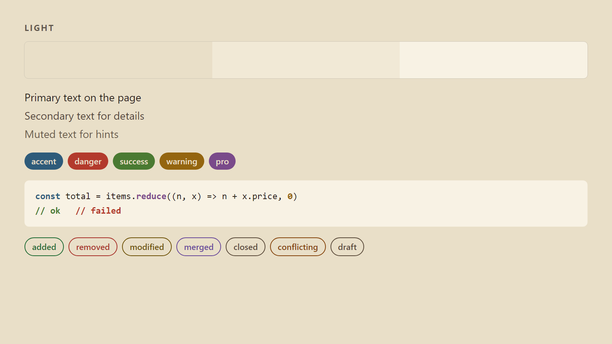<br>**paperback**](themes/paperback)
[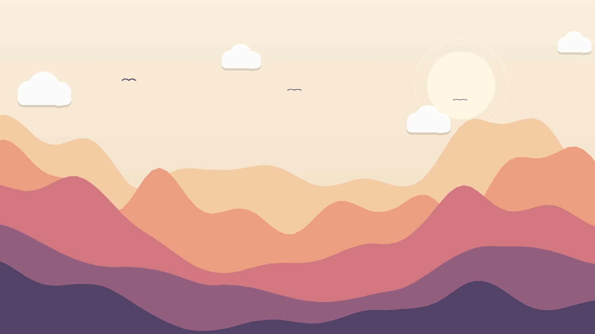<br>**papercut-peaks**](themes/papercut-peaks) | [<br>**papercut-peaks-night**](themes/papercut-peaks-night) | [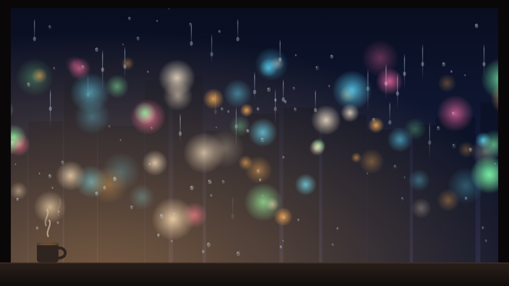<br>**rainy-window**](themes/rainy-window)
[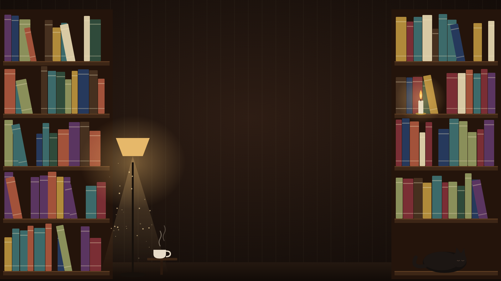<br>**reading-room**](themes/reading-room) | [<br>**retro-grid**](themes/retro-grid) | [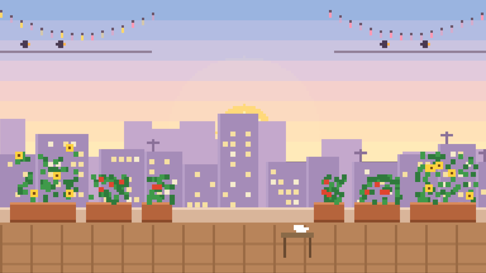<br>**rooftop-garden**](themes/rooftop-garden)
[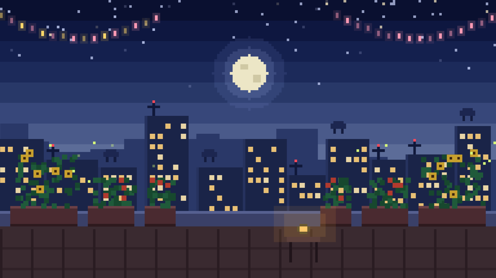<br>**rooftop-garden-night**](themes/rooftop-garden-night) | [<br>**sakura-drift**](themes/sakura-drift) | [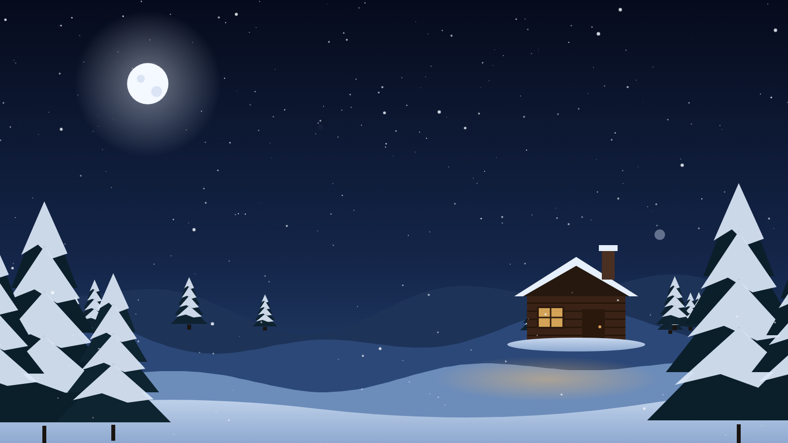<br>**snow-cabin**](themes/snow-cabin)
[<br>**snow-cabin-day**](themes/snow-cabin-day) | [<br>**sunny-shore**](themes/sunny-shore) | [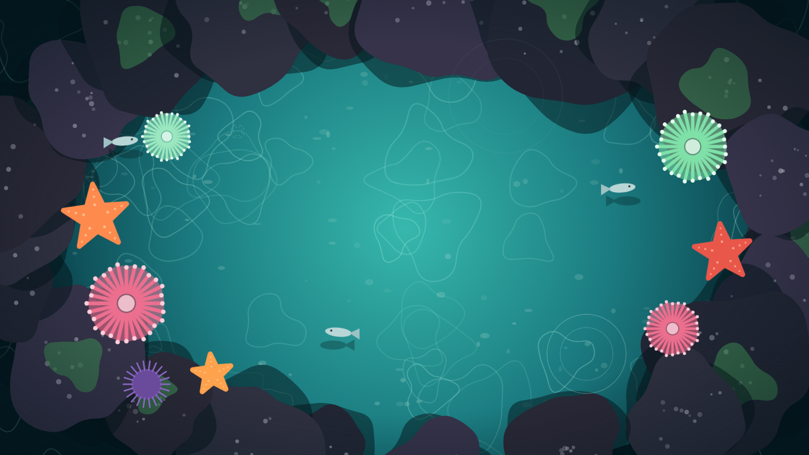<br>**tide-pool**](themes/tide-pool)
[<br>**torch-dungeon**](themes/torch-dungeon) | |
<!-- previews:end -->

*Previews show each theme's backdrop alone, not the app. [`docs/gallery.html`](docs/gallery.html) shows every backdrop animated: open it in a browser after cloning.*

<!-- themes:start -->
| Theme | What it is |
| --- | --- |
| [**abyss-lantern**](themes/abyss-lantern) | The deep sea: sun shafts fading into the dark, glowing jellyfish, swaying kelp, bubbles and a passing school of fish. Dark. |
| [**arcade-hall**](themes/arcade-hall) | A pixel-art arcade at night: rows of cabinets playing their own little games, neon tubes and a patterned carpet. Dark. |
| [**aurora-field**](themes/aurora-field) | Northern lights over a frozen lake ringed by pines, with twinkling stars and the odd shooting star. Dark. |
| [**beacon-cove**](themes/beacon-cove) | An animated pixel-art theme that follows your clock: a lighthouse cape and sea from night through dawn, day and dusk, with a moving sun and moon, drifting clouds, a small boat and fireflies. |
| [**code-rain**](themes/code-rain) | Columns of falling glyphs in phosphor green, bright at the head and fading behind, dimmer under the chat. Dark. |
| [**colorblind-safe-dark**](themes/colorblind-safe-dark) | A dark theme whose colors stay apart for red-green and blue-yellow color blindness: blue and orange for added and removed, and a different lightness for each status. Colors only. |
| [**colorblind-safe-light**](themes/colorblind-safe-light) | A light theme whose colors stay apart for red-green and blue-yellow color blindness: blue and orange for added and removed, and a different lightness for each status. Colors only. |
| [**contour-map**](themes/contour-map) | A topographic survey on warm paper: elevation lines draw themselves one height at a time around a flat basin. Light. |
| [**contour-map-night**](themes/contour-map-night) | The topographic survey in pale ink on blue-black paper, with the contours drawing themselves. Dark. |
| [**desert-night**](themes/desert-night) | A desert after dark: stars and a cold moon over blue-violet mesas, saguaros in silhouette, a campfire with sparks and an owl. Dark. |
| [**desert-noon**](themes/desert-noon) | A bright desert at midday: red mesas, a pale sun, saguaros, heat shimmer, drifting dust and a tumbleweed. Light. |
| [**fog-valley**](themes/fog-valley) | A misty mountain morning: blue ridges with fog drifting between them, low sun rays, a flock of birds and a far balloon. Light. |
| [**fog-valley-night**](themes/fog-valley-night) | A misty mountain night: a moon over deep-blue ridges, pale fog drifting between them, fireflies in the pines and a sky lantern rising. Dark. |
| [**forest-floor**](themes/forest-floor) | Moss, bark and fern: a green-brown dark theme and a pale lichen light one, with a fern-green accent. Colors only. |
| [**graphite**](themes/graphite) | Neutral graphite grays with one steel-blue accent. Quiet and tool-like, light and dark, colors only. |
| [**halftone-harbor**](themes/halftone-harbor) | A two-ink halftone print of a harbor at sunset: a coral sun and its wake, blue water, a headland with a lighthouse, two boats. Light. |
| [**halftone-harbor-night**](themes/halftone-harbor-night) | The halftone harbor printed on night-blue stock: an ember sun and pale-blue water in breathing dots. Dark. |
| [**hearth**](themes/hearth) | A warm theme: espresso and cream surfaces, terracotta accents, and a slow dusk backdrop with embers drifting up. |
| [**high-contrast-dark**](themes/high-contrast-dark) | Pure black and white with bright, saturated colors: text well past the AA bar on every surface, and strong borders. Dark, colors only. |
| [**high-contrast-light**](themes/high-contrast-light) | Black on white with deep, saturated colors: text well past the AA bar on every surface, and strong borders. Light, colors only. |
| [**low-orbit**](themes/low-orbit) | A pixel-art view of space: a ringed gas giant, a small moon, a nebula, parallax stars, a passing ship and shooting stars. Dark. |
| [**meadow-hours**](themes/meadow-hours) | A rolling meadow that follows your clock: dawn, day, dusk and night, with a moving sun and moon, butterflies by day and fireflies after dark. Dark. |
| [**midnight-ink**](themes/midnight-ink) | Blue-black ink with pale paper-white text and a periwinkle accent. Dark, colors only. |
| [**moonlit-shore**](themes/moonlit-shore) | A pixel-art beach at night: a moon and its glitter on the sea, stars, a campfire with sparks, a lantern boat and a crab. Dark. |
| [**neon-rain**](themes/neon-rain) | A pixel-art city at night in the rain: towers with lit windows, buzzing neon signs, a wet street and a passing car. Dark. |
| [**night-train**](themes/night-train) | A night run seen from a carriage window: hills, town lights and telegraph poles sliding past under a thin moon. Dark. |
| [**paperback**](themes/paperback) | A well-read paperback: cream pages, brown-black ink and an ink-blue accent. Light, colors only. |
| [**papercut-peaks**](themes/papercut-peaks) | Five sheets of colored paper layered into mountains, each casting a soft shadow, with paper clouds and birds. Light. |
| [**papercut-peaks-night**](themes/papercut-peaks-night) | The paper-cut mountains in deep indigo under a paper moon and cut-out stars. Dark. |
| [**rainy-window**](themes/rainy-window) | A night city seen through a rain-streaked window: soft bokeh lights, drops sliding down the glass, a warm lamp and a steaming mug. Dark. |
| [**reading-room**](themes/reading-room) | A cozy library at night: tall shelves of books, a floor lamp with dust turning in its light, a candle, a cup of tea and a sleeping cat. Dark. |
| [**retro-grid**](themes/retro-grid) | A neon horizon: a slatted sun, wireframe mountains and a perspective grid that rolls toward you. Dark. |
| [**rooftop-garden**](themes/rooftop-garden) | A pixel-art rooftop at golden hour: a pastel skyline, planters of sunflowers and tomatoes, string lights, birds on a wire and a kite. Light. |
| [**rooftop-garden-night**](themes/rooftop-garden-night) | A pixel-art rooftop after dark: a moon and stars over a skyline of lit windows, glowing string lights, fireflies and a lantern. Dark. |
| [**sakura-drift**](themes/sakura-drift) | A spring dusk of pastel sky, misty hills and a blossoming tree, with petals drifting down. Light and dark. |
| [**snow-cabin**](themes/snow-cabin) | A winter night: a log cabin with a lit window, smoke curling from the chimney, snowy pines and snow falling in three layers. Dark. |
| [**snow-cabin-day**](themes/snow-cabin-day) | A winter noon: a pale blue sky and low sun, white hills, a log cabin with smoke from its chimney and snow falling in three layers. Light. |
| [**sunny-shore**](themes/sunny-shore) | A pixel-art beach on a bright day: a pulsing sun, drifting clouds, a sparkling sea, rolling foam, palms, gulls and a crab. Light. |
| [**tide-pool**](themes/tide-pool) | Looking straight down into a rock pool: breathing anemones, starfish, rippling light, drops making rings and small fish. Dark. |
| [**torch-dungeon**](themes/torch-dungeon) | A pixel-art dungeon wall: two flickering torches, a dark doorway with watching eyes, bats, a hopping slime and a treasure chest. Dark. |
<!-- themes:end -->

## Install

You need the Claude Code desktop app. Themes draw there (and in the mobile app); the terminal and editor extensions don't draw themes.

There are two ways to install: **the whole library as one plugin** (recommended), or **one theme at a time**.

### The whole library: `theme-library`

One plugin holds every theme and a switcher, so you install once and change themes whenever you like.

In the desktop app: click **+** next to the prompt box, then **Plugins**, choose **Add marketplace** and enter `PerspicaciousGuy/ClaudeCodeThemes`, then **Add plugin** and pick `theme-library`.

Or at the prompt of a terminal Claude Code session:

```
/plugin install theme-library --marketplace PerspicaciousGuy/ClaudeCodeThemes
```

Or from a shell:

```bash
claude plugin install theme-library --marketplace PerspicaciousGuy/ClaudeCodeThemes
```

Then, in a session:

| Command | What it does |
| --- | --- |
| `/ccthemes` | Opens a card of themes you can filter (dark, light, pixel, vector, still, clock): Apply, Preview (20 seconds, not kept) and No theme |
| `/ccthemes <name>` | Applies a theme, such as `/ccthemes neon-rain` (a unique start of the name works) |
| `/ccthemes dark`, `light`, `pixel`, `vector`, `still`, `clock` | Opens the card with that filter on |
| `/ccthemes find <words>` | Searches names, tags and descriptions, such as `find beach` |
| `/ccthemes auto` | Day and night: themes with a twin switch between their light and dark halves by your clock |
| `/ccthemes list` | Names every theme |
| `/ccthemes random` / `next` / `prev` | Applies a random, the next or the previous theme, optionally within a filter |
| `/ccthemes off` | Clears the theme |

The theme you apply is kept for later sessions, in every project. In a new session no theme shows until you send a first message.

### One theme at a time

Install a single theme instead of the library:

```
/plugin install beacon-cove --marketplace PerspicaciousGuy/ClaudeCodeThemes
```

```bash
claude plugin install beacon-cove --marketplace PerspicaciousGuy/ClaudeCodeThemes
```

Replace `beacon-cove` with any theme's name from the table above. The first time, Claude Code asks `Add marketplace?`: answer `y`, then choose a scope (the user scope applies to every session). A theme installed from a terminal at the user scope also loads in your desktop app's local sessions. The theme applies at the start of a session: if it doesn't show, start a new session.

A session has one theme, so if two single themes (or one and the library) are installed they overwrite each other. Use one route or the other, or switch with:

```bash
claude plugin disable hearth
claude plugin enable beacon-cove
```

To remove a theme: `claude plugin uninstall <theme>`.

## Good to know

- **If the backdrop doesn't show.** The colors can apply while the scene stays hidden. On Windows, turn on Settings, Personalization, Colors, Transparency effects. Then start a new session and send a message.

- **Light and dark.** Hearth follows your app's light or dark mode. Beacon Cove is a dark theme and keeps the app dark.
- **Reduced motion.** Animated backdrops stop moving when your system asks for reduced motion.
- **Permission prompts** always keep the app's own look.
- **Beacon Cove and your clock.** It reads your computer's local time and redraws its sky every ten minutes.

## Make your own

Start from [`template/`](template), a minimal colors-only theme, and read [CONTRIBUTING.md](CONTRIBUTING.md) for how a theme works, the quality bar, how to test one locally, and how to add it here.

## License

[MIT](LICENSE). Each theme's art is original to this repository.
