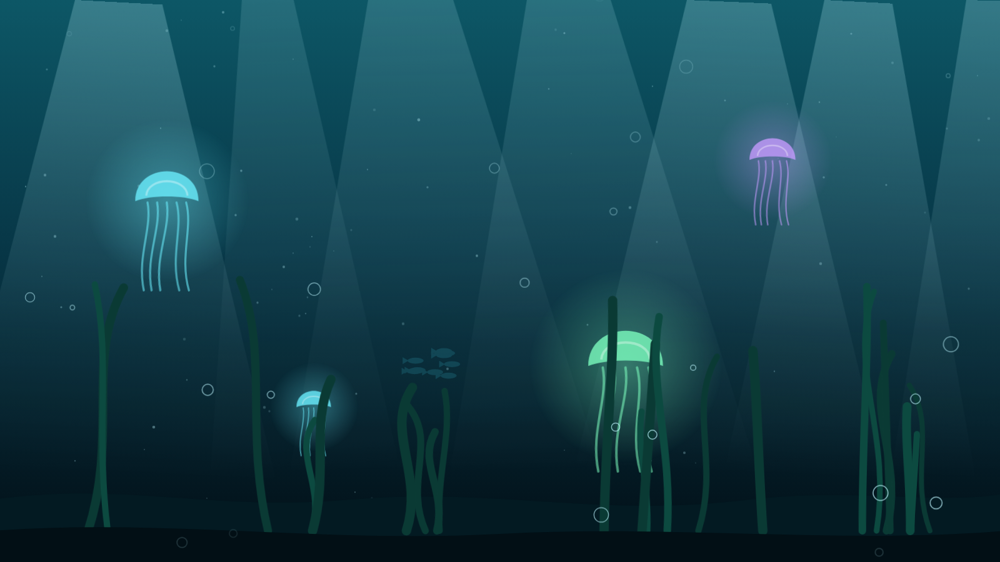
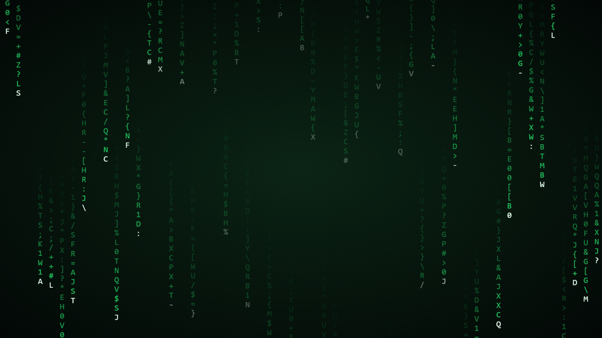
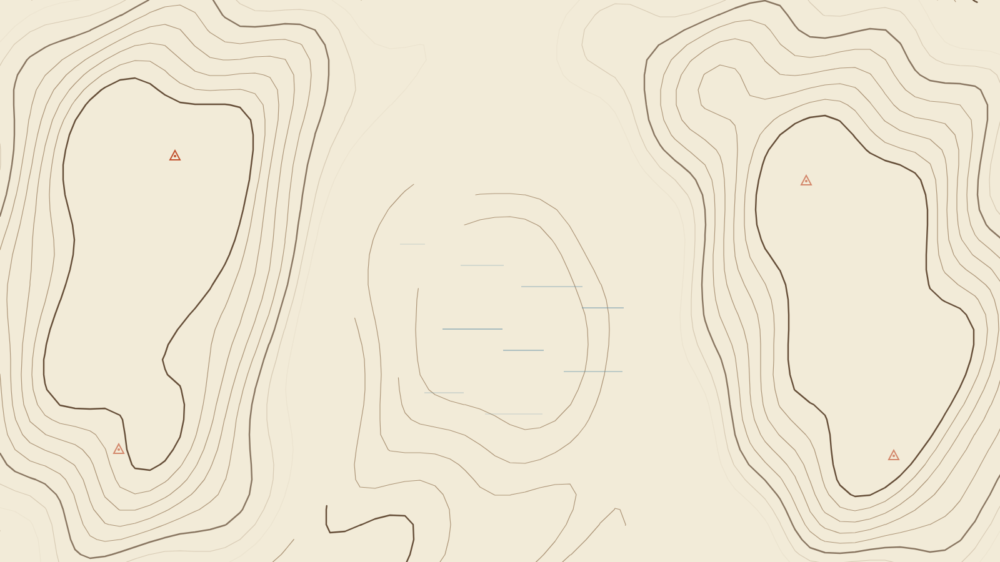
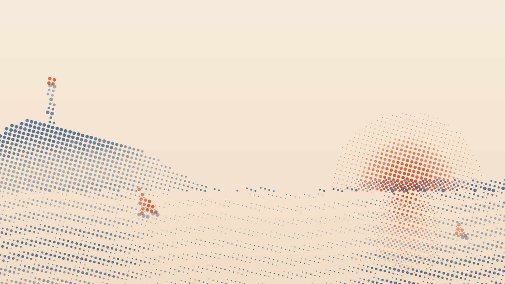
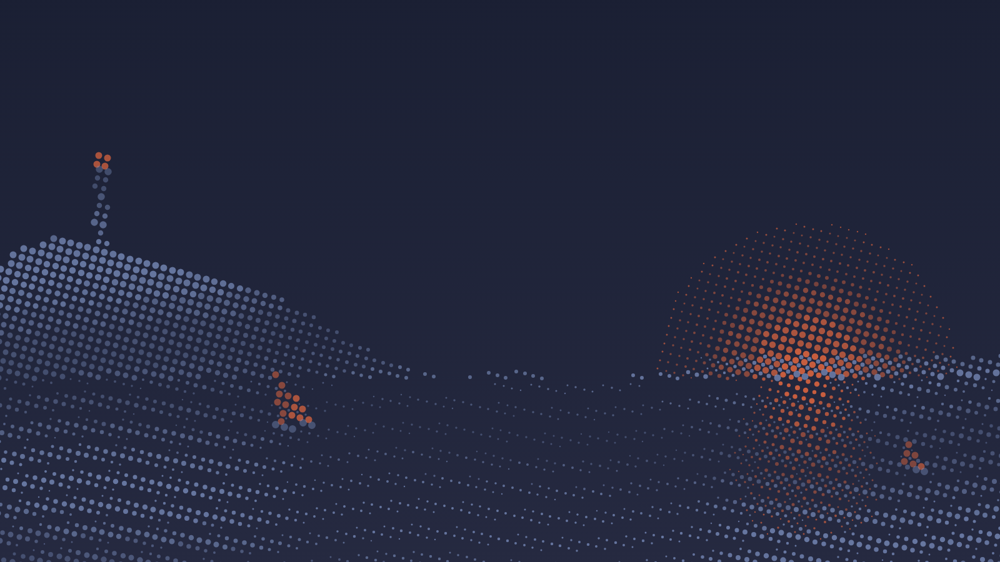
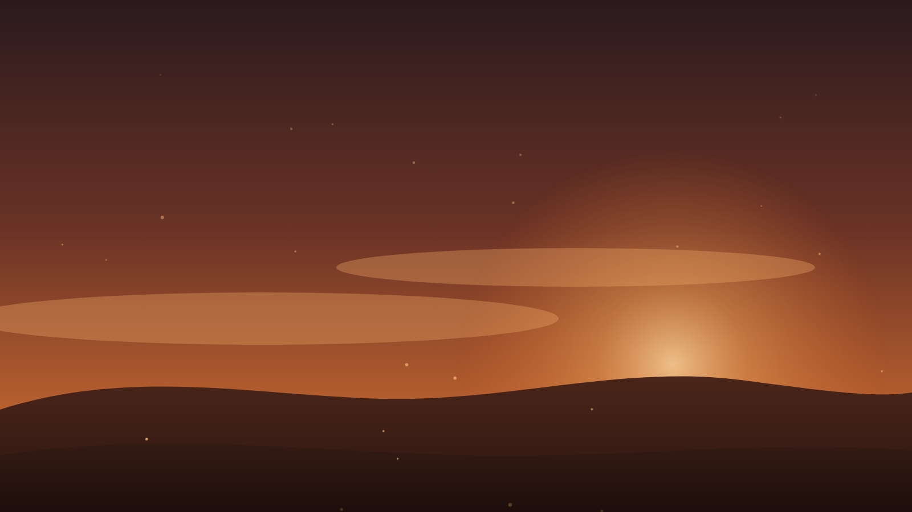
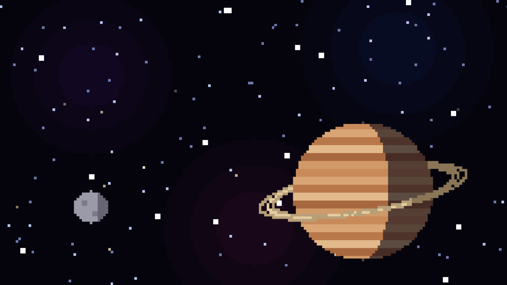
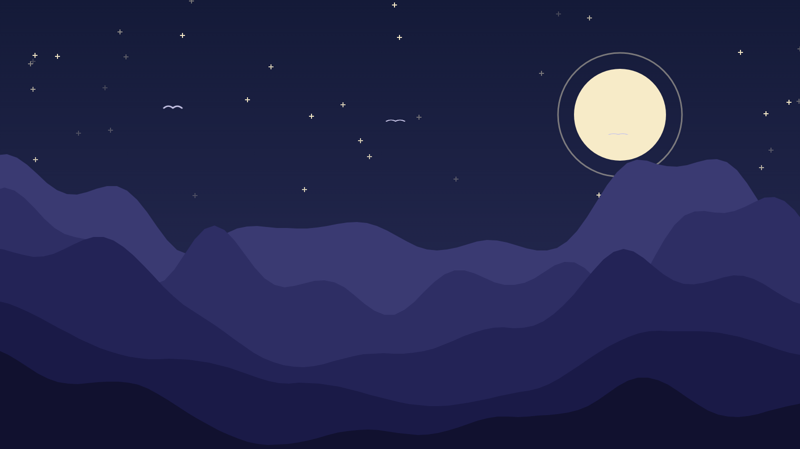
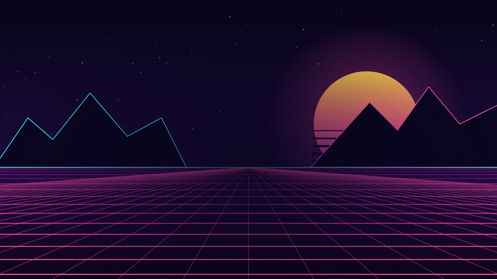

# Claude Code Themes

Themes for the **Claude Code desktop app**: custom colors, and animated backdrops that play behind your conversation. Each theme is a small plugin you can install in one step, and this repository is also a kit for making your own.

## Themes

<!-- previews:start -->
|   |   |   |
| --- | --- | --- |
[<br>**abyss-lantern**](themes/abyss-lantern) | [<br>**aurora-field**](themes/aurora-field) | [<br>**beacon-cove**](themes/beacon-cove)
[<br>**code-rain**](themes/code-rain) | [<br>**contour-map**](themes/contour-map) | [<br>**contour-map-night**](themes/contour-map-night)
[<br>**halftone-harbor**](themes/halftone-harbor) | [<br>**halftone-harbor-night**](themes/halftone-harbor-night) | [<br>**hearth**](themes/hearth)
[<br>**low-orbit**](themes/low-orbit) | [<br>**neon-rain**](themes/neon-rain) | [<br>**papercut-peaks**](themes/papercut-peaks)
[<br>**papercut-peaks-night**](themes/papercut-peaks-night) | [<br>**rainy-window**](themes/rainy-window) | [<br>**retro-grid**](themes/retro-grid)
[<br>**sakura-drift**](themes/sakura-drift) | |
<!-- previews:end -->

*Previews show each theme's backdrop alone, not the app. [`docs/gallery.html`](docs/gallery.html) shows every backdrop animated: open it in a browser after cloning.*

<!-- themes:start -->
| Theme | What it is |
| --- | --- |
| [**abyss-lantern**](themes/abyss-lantern) | The deep sea: sun shafts fading into the dark, glowing jellyfish, swaying kelp, bubbles and a passing school of fish. Dark. |
| [**aurora-field**](themes/aurora-field) | Northern lights over a frozen lake ringed by pines, with twinkling stars and the odd shooting star. Dark. |
| [**beacon-cove**](themes/beacon-cove) | An animated pixel-art theme that follows your clock: a lighthouse cape and sea from night through dawn, day and dusk, with a moving sun and moon, drifting clouds, a small boat and fireflies. |
| [**code-rain**](themes/code-rain) | Columns of falling glyphs in phosphor green, bright at the head and fading behind, dimmer under the chat. Dark. |
| [**contour-map**](themes/contour-map) | A topographic survey on warm paper: elevation lines draw themselves one height at a time around a flat basin. Light. |
| [**contour-map-night**](themes/contour-map-night) | The topographic survey in pale ink on blue-black paper, with the contours drawing themselves. Dark. |
| [**halftone-harbor**](themes/halftone-harbor) | A two-ink halftone print of a harbor at sunset: a coral sun and its wake, blue water, a headland with a lighthouse, two boats. Light. |
| [**halftone-harbor-night**](themes/halftone-harbor-night) | The halftone harbor printed on night-blue stock: an ember sun and pale-blue water in breathing dots. Dark. |
| [**hearth**](themes/hearth) | A warm theme: espresso and cream surfaces, terracotta accents, and a slow dusk backdrop with embers drifting up. |
| [**low-orbit**](themes/low-orbit) | A pixel-art view of space: a ringed gas giant, a small moon, a nebula, parallax stars, a passing ship and shooting stars. Dark. |
| [**neon-rain**](themes/neon-rain) | A pixel-art city at night in the rain: towers with lit windows, buzzing neon signs, a wet street and a passing car. Dark. |
| [**papercut-peaks**](themes/papercut-peaks) | Five sheets of colored paper layered into mountains, each casting a soft shadow, with paper clouds and birds. Light. |
| [**papercut-peaks-night**](themes/papercut-peaks-night) | The paper-cut mountains in deep indigo under a paper moon and cut-out stars. Dark. |
| [**rainy-window**](themes/rainy-window) | A night city seen through a rain-streaked window: soft bokeh lights, drops sliding down the glass, a warm lamp and a steaming mug. Dark. |
| [**retro-grid**](themes/retro-grid) | A neon horizon: a slatted sun, wireframe mountains and a perspective grid that rolls toward you. Dark. |
| [**sakura-drift**](themes/sakura-drift) | A spring dusk of pastel sky, misty hills and a blossoming tree, with petals drifting down. Light and dark. |
<!-- themes:end -->

## Install

You need the Claude Code desktop app. Themes draw there (and in the mobile app); the terminal and editor extensions don't draw themes.

There are two ways to install: **the whole library as one plugin** (recommended), or **one theme at a time**.

### The whole library: `theme-library`

One plugin holds every theme and a switcher, so you install once and change themes whenever you like.

In the desktop app: click **+** next to the prompt box, then **Plugins**, choose **Add marketplace** and enter `PerspicaciousGuy/ClaudeCodeThemes`, then **Add plugin** and pick `theme-library`.

Or at the prompt of a terminal Claude Code session:

```
/plugin install theme-library --marketplace PerspicaciousGuy/ClaudeCodeThemes
```

Or from a shell:

```bash
claude plugin install theme-library --marketplace PerspicaciousGuy/ClaudeCodeThemes
```

Then, in a session:

| Command | What it does |
| --- | --- |
| `/ccthemes` | Opens a card with every theme: Apply, Preview (20 seconds, not kept) and No theme |
| `/ccthemes <name>` | Applies a theme, such as `/ccthemes neon-rain` (a unique start of the name works) |
| `/ccthemes list` | Names every theme |
| `/ccthemes random` / `next` | Applies a random or the next theme |
| `/ccthemes off` | Clears the theme |

The theme you apply is kept for later sessions, in every project. In a new session no theme shows until you send a first message.

### One theme at a time

Install a single theme instead of the library:

```
/plugin install beacon-cove --marketplace PerspicaciousGuy/ClaudeCodeThemes
```

```bash
claude plugin install beacon-cove --marketplace PerspicaciousGuy/ClaudeCodeThemes
```

Replace `beacon-cove` with any theme's name from the table above. The first time, Claude Code asks `Add marketplace?`: answer `y`, then choose a scope (the user scope applies to every session). A theme installed from a terminal at the user scope also loads in your desktop app's local sessions. The theme applies at the start of a session: if it doesn't show, start a new session.

A session has one theme, so if two single themes (or one and the library) are installed they overwrite each other. Use one route or the other, or switch with:

```bash
claude plugin disable hearth
claude plugin enable beacon-cove
```

To remove a theme: `claude plugin uninstall <theme>`.

## Good to know

- **If the backdrop doesn't show.** The colors can apply while the scene stays hidden. On Windows, turn on Settings, Personalization, Colors, Transparency effects. Then start a new session and send a message.

- **Light and dark.** Hearth follows your app's light or dark mode. Beacon Cove is a dark theme and keeps the app dark.
- **Reduced motion.** Animated backdrops stop moving when your system asks for reduced motion.
- **Permission prompts** always keep the app's own look.
- **Beacon Cove and your clock.** It reads your computer's local time and redraws its sky every ten minutes.

## Make your own

Start from [`template/`](template), a minimal colors-only theme, and read [CONTRIBUTING.md](CONTRIBUTING.md) for how a theme works, the quality bar, how to test one locally, and how to add it here.

## License

[MIT](LICENSE). Each theme's art is original to this repository.
