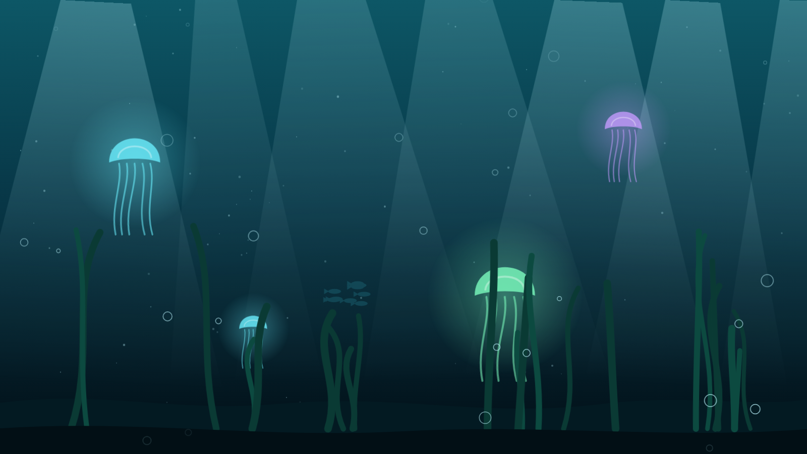

# Abyss Lantern

The deep sea. Sun shafts sway down and fade into the dark, jellyfish pulse and glow, kelp sways, bubbles rise and a school of fish passes far off.

It is a dark theme and keeps the app dark. The panels are frosted over the scene so text stays readable. Animations stop if your system asks for reduced motion.

Install: `/plugin install abyss-lantern --marketplace PerspicaciousGuy/ClaudeCodeThemes` (see the [repository README](../../README.md#install) for the desktop app and shell steps).
