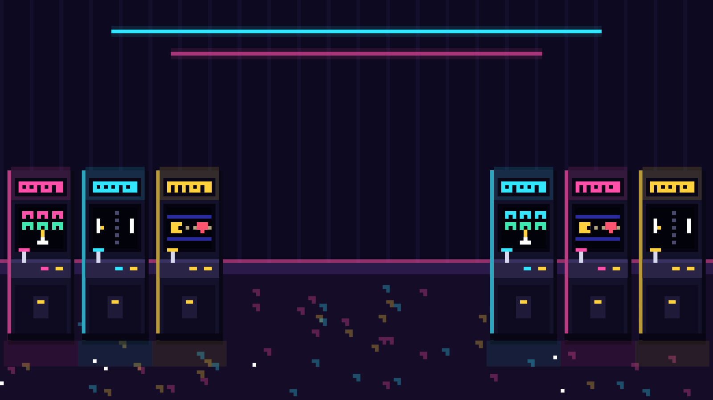

# Arcade Hall

A pixel-art arcade at night. Three cabinets stand at each side, their screens playing invaders, pong and a maze chase; neon tubes buzz along the wall and little lights wink on the carpet. The middle is left open for the chat.

It is a dark theme and keeps the app dark. The panels are frosted over the scene so text stays readable. Animations stop if your system asks for reduced motion.

Install: `/plugin install arcade-hall --marketplace PerspicaciousGuy/ClaudeCodeThemes` (see the [repository README](../../README.md#install) for the desktop app and shell steps).
