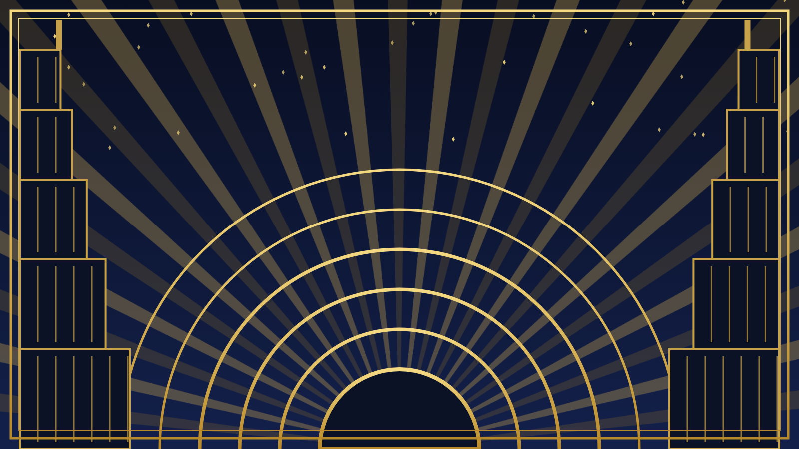

# Art Deco

A gold sunburst fans out from the bottom centre over deep navy, with concentric arcs below it and stepped towers lined in gold at both sides. A gold border frames the screen and a shimmer of light travels across the gold now and then.

It is a dark theme and keeps the app dark. The panels are frosted over the scene so text stays readable. Animations stop if your system asks for reduced motion.

Install: `/plugin install art-deco --marketplace PerspicaciousGuy/ClaudeCodeThemes` (see the [repository README](../../README.md#install) for the desktop app and shell steps).
