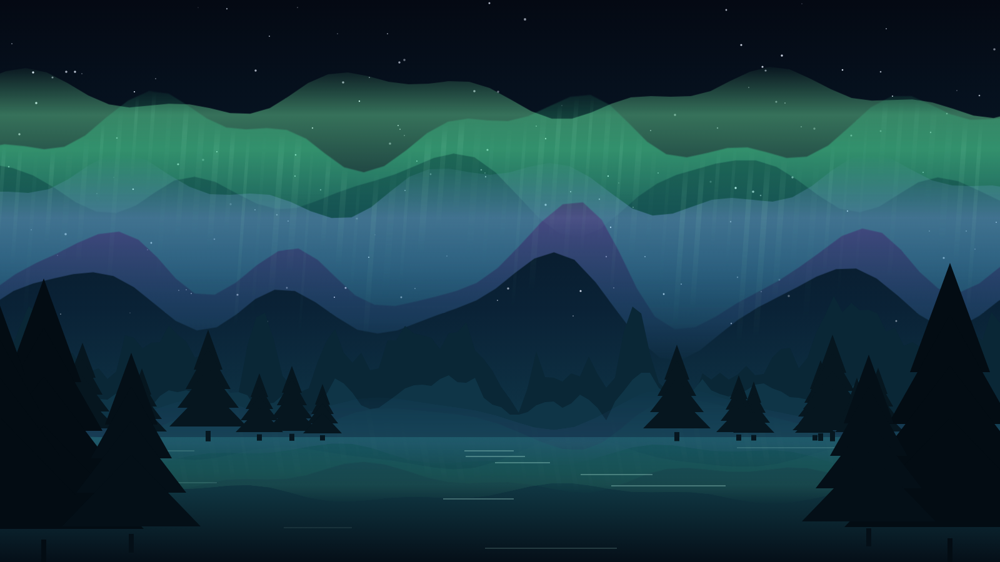

# Aurora Field

Northern lights over a frozen lake ringed by pines. Three curtains of green, violet and mint sway slowly and are mirrored on the ice; stars twinkle and a shooting star passes now and then.

It is a dark theme and keeps the app dark. The panels are frosted over the scene so text stays readable. Animations stop if your system asks for reduced motion.

Install: `/plugin install aurora-field --marketplace PerspicaciousGuy/ClaudeCodeThemes` (see the [repository README](../../README.md#install) for the desktop app and shell steps).
