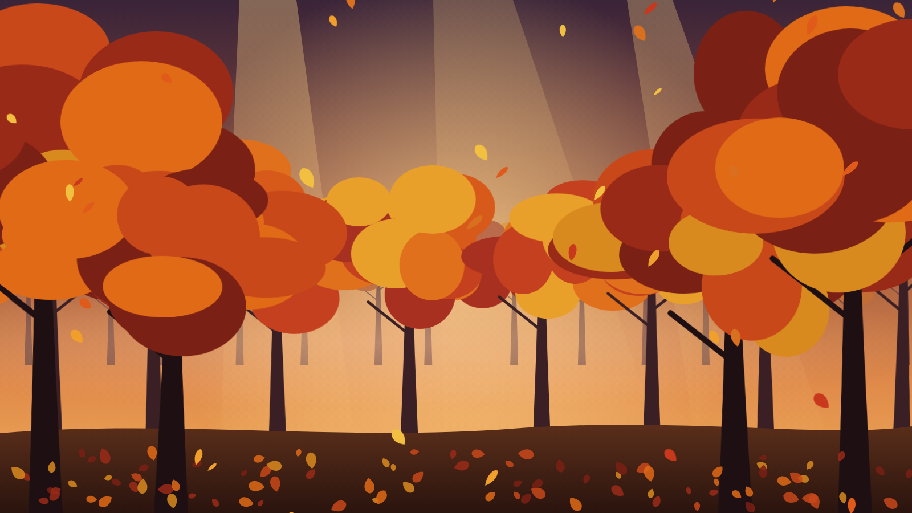

# Autumn Forest

Trees in layers wear red, orange and gold at golden dusk. Leaves spiral down through slanting light, mist drifts between the trunks and fallen leaves carpet the ground. The big trees stay at the sides so the middle is open for the chat.

It is a dark theme and keeps the app dark. The panels are frosted over the scene so text stays readable. Animations stop if your system asks for reduced motion.

Install: `/plugin install autumn-forest --marketplace PerspicaciousGuy/ClaudeCodeThemes` (see the [repository README](../../README.md#install) for the desktop app and shell steps).
