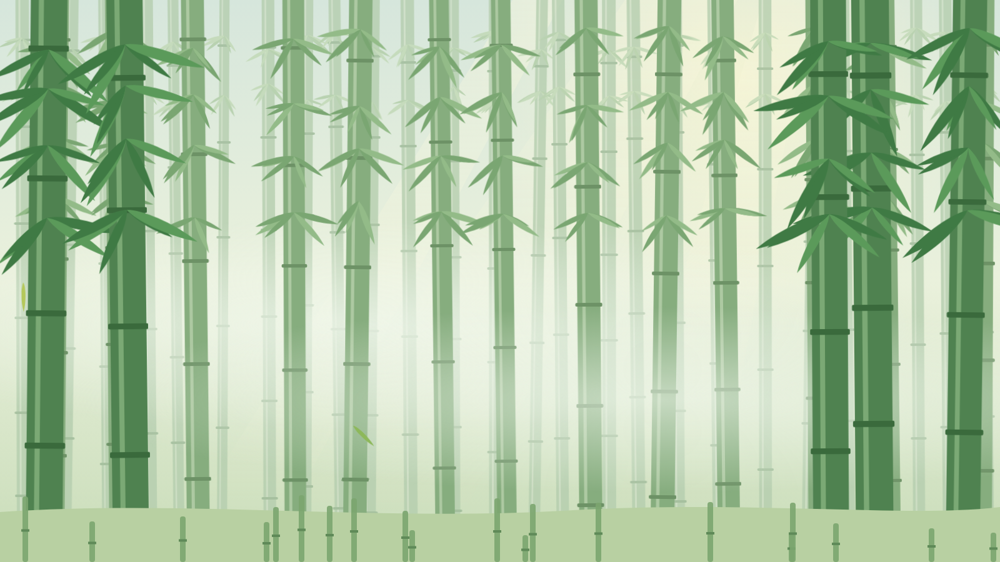

# Bamboo Grove

Tall bamboo stalks stand in layers, the far ones fading into pale morning mist. The stalks and leaves sway at different speeds, slow shafts of light shift through the grove and a few leaves fall. The middle stays soft and open.

It is a light theme and keeps the app light. The panels are frosted over the scene so text stays readable. Animations stop if your system asks for reduced motion.

Install: `/plugin install bamboo-grove --marketplace PerspicaciousGuy/ClaudeCodeThemes` (see the [repository README](../../README.md#install) for the desktop app and shell steps).
