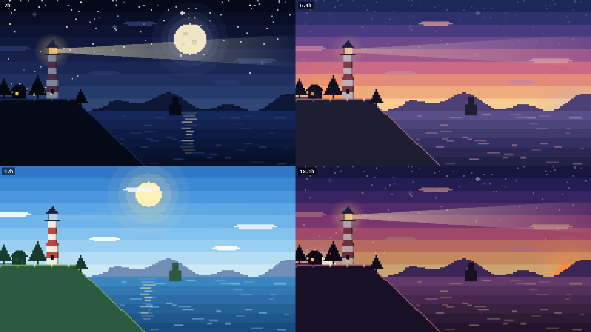

# Beacon Cove

An animated pixel-art lighthouse on a cape by the sea, drawn on a 192×108 pixel grid.

It follows your computer's clock. Night has a moon, stars, a sweeping lighthouse beam and fireflies; dawn and dusk blend purple, magenta and amber; day is blue sky and green grass. The sun and moon travel across the sky, and the lamp comes on as it gets dark. A small boat crosses the sea, and clouds drift.

The sky is redrawn every ten minutes. Animations stop if your system asks for reduced motion. The panels are dark at every hour and frosted over the scene.

Install it from the repository README: `/plugin install beacon-cove --marketplace PerspicaciousGuy/ClaudeCodeThemes`.

Files: `hooks/scene.js` builds the SVG for a given hour, `hooks/register.tsx` sets the colors and draws it.
