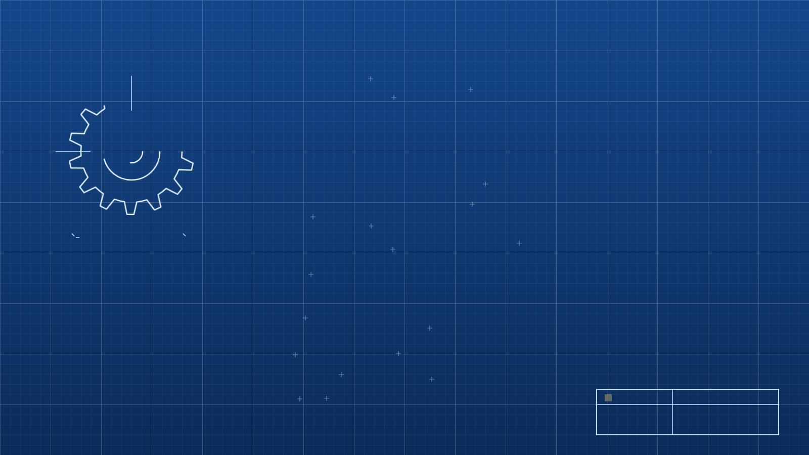

# Blueprint

A fine grid on deep blue paper. A gear, a house elevation, an I-beam section and a compass drawing trace themselves in white line with dimension marks, hold, then fade and start again. The drawings stay at the sides and the middle is clear paper for the chat.

It is a dark theme and keeps the app dark. The panels are frosted over the scene so text stays readable. Animations stop if your system asks for reduced motion.

Install: `/plugin install blueprint --marketplace PerspicaciousGuy/ClaudeCodeThemes` (see the [repository README](../../README.md#install) for the desktop app and shell steps).
