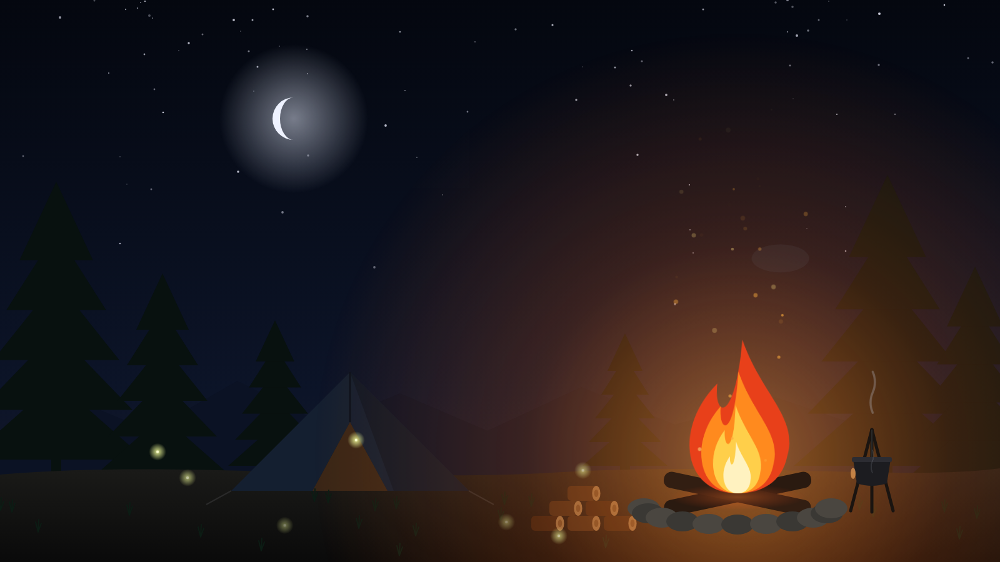

# Campfire

A night camp whose scene follows your usage, so it also tells you how much you have left.

- **The fire is your 5-hour limit.** A roaring fire means most of the window is left. It shrinks as you use it and is a bed of embers when you are close to the limit. It follows the limit on a Claude subscription; with no limit reading it follows the context window instead.
- **The woodpile is your context window.** Up to six logs sit beside the fire, one for each sixth of the window that is left. It shrinks as the conversation grows and refills after a compact or a clear.
- **Sparks rise faster** while Claude is working.
- The tent glows with the fire, a pot steams on a tripod, smoke drifts, fireflies move over the grass and a crescent moon hangs over far mountains. The big pine trees stay at the sides so the middle is clear for the chat.

It is a dark theme and keeps the app dark. The panels are frosted over the scene so text stays readable. Animations stop if your system asks for reduced motion.

## Use it

Install: `/plugin install campfire --marketplace PerspicaciousGuy/ClaudeCodeThemes` (see the [repository README](../../README.md#install) for the desktop app and shell steps).

Run `/fire` to put the Campfire look on. If you also use `theme-library`, whichever theme was set last wins, so run `/fire` whenever you want the camp back.

| Command | What it does |
| --- | --- |
| `/fire` or `/fire auto` | Apply the look and follow your real usage. |
| `/fire 0` to `/fire 5` | Hold the fire at a level to see it, until `/fire auto`. |
| `/fire wood 0` to `/fire wood 6` | Show a woodpile size until the next usage change. |

The status line shows what the fire is reading, for example `fire: 88% of 5h left`.

## Why it is a separate plugin

Every other theme is a fixed scene, so they live together in `theme-library`. The campfire redraws as your usage changes, so it is its own plugin and is not part of the library picker. The picture above shows the full fire.
