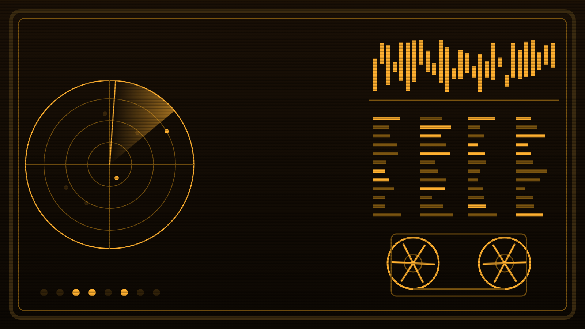

# Cassette Futurism

An amber monochrome console in near-black. A radar sweeps on the left, a spectrum pulses and data scrolls on the right, two cassette reels turn, status lights blink and scanlines roll down the screen.

It is a dark theme and keeps the app dark. The panels are frosted over the scene so text stays readable. Animations stop if your system asks for reduced motion.

Install: `/plugin install cassette-futurism --marketplace PerspicaciousGuy/ClaudeCodeThemes` (see the [repository README](../../README.md#install) for the desktop app and shell steps).
