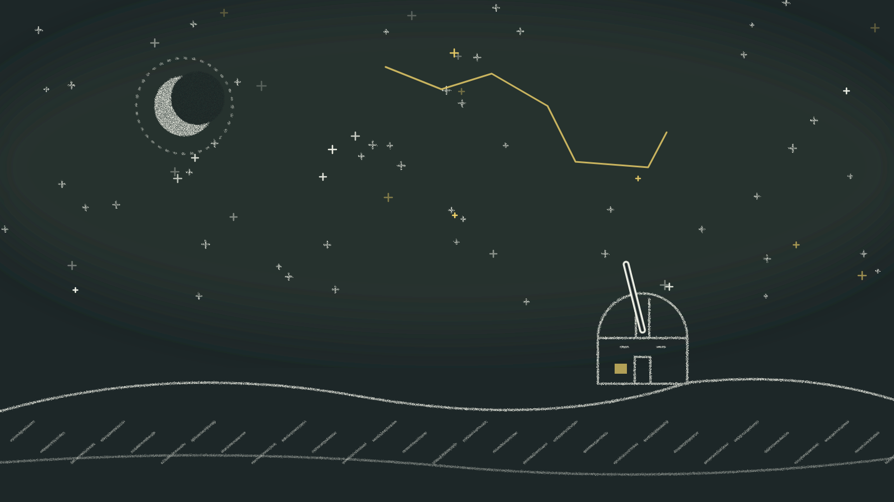

# Chalk Observatory

A night sky drawn in chalk on a slate board. A small observatory sits on a hatched hill with its telescope sweeping slowly across the sky, a crescent moon wears a dotted halo, chalk stars twinkle, a yellow constellation draws itself and fades, and now and then a shooting star crosses the top.

It is a dark theme and keeps the app dark. The panels are frosted over the scene so text stays readable. Animations stop if your system asks for reduced motion.

Install: `/plugin install chalk-observatory --marketplace PerspicaciousGuy/ClaudeCodeThemes` (see the [repository README](../../README.md#install) for the desktop app and shell steps).
