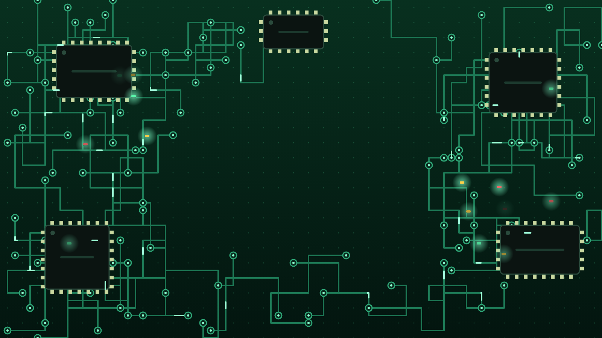

# Circuit Board

A green circuit board with traces running between pads and chips. Bright pulses of light travel along the traces and small colored LEDs blink on their own beats. Everything stays toward the edges so the middle is open for the chat.

It is a dark theme and keeps the app dark. The panels are frosted over the scene so text stays readable. Animations stop if your system asks for reduced motion.

Install: `/plugin install circuit-board --marketplace PerspicaciousGuy/ClaudeCodeThemes` (see the [repository README](../../README.md#install) for the desktop app and shell steps).
