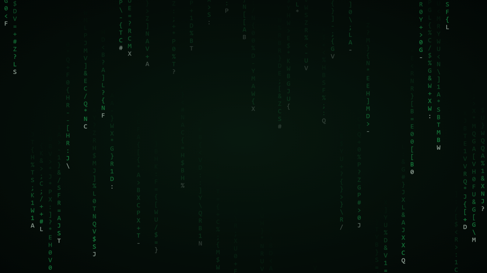

# Code Rain Calm

A calm version of [code-rain](../code-rain): the same scene, slowed to about 40% of its speed and softened under a veil, with heavier frosted panels behind the chat. It is for when motion or contrast pulls your eye away from the words.

The colors are the same as code-rain, so the app looks the same around it. Animations stop if your system asks for reduced motion.

Install: `/plugin install code-rain-calm --marketplace PerspicaciousGuy/ClaudeCodeThemes` (see the [repository README](../../README.md#install) for the desktop app and shell steps).
