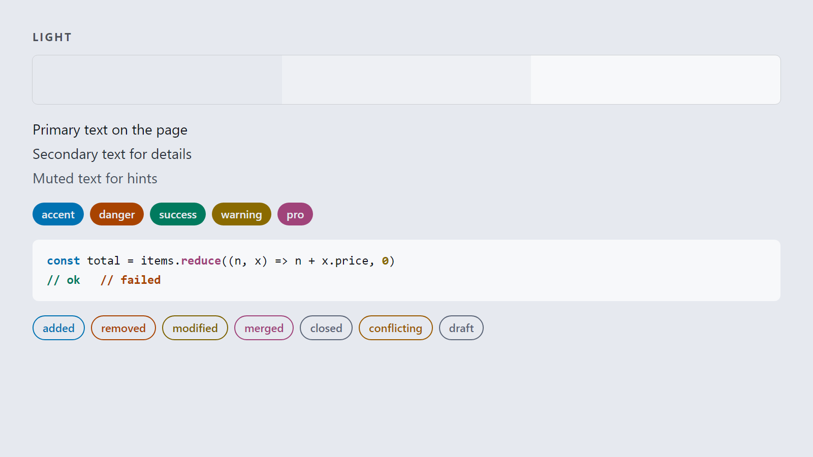

# Colorblind Safe Light

Built on the Okabe-Ito colors, darkened to read on a light page. Success is a blue-green and danger a vermillion that differ in lightness as well as hue, warning is a dark yellow, and the git colors use blue for added and orange for removed instead of green and red.

It is a light theme and keeps the app light. It changes colors only: there is no backdrop, so the app keeps its own look otherwise.

Its twin is `colorblind-safe-dark`: with day and night on in the `theme-library` plugin, the library shows one by day and the other after dark.

Install: `/plugin install colorblind-safe-light --marketplace PerspicaciousGuy/ClaudeCodeThemes` (see the [repository README](../../README.md#install) for the desktop app and shell steps).
