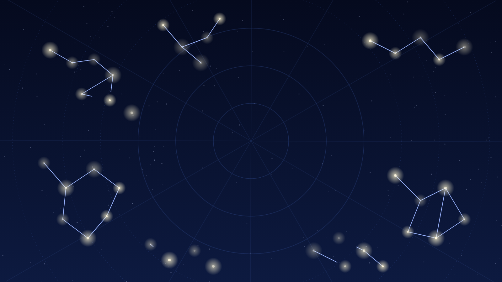

# Constellations

A slowly turning celestial chart on deep blue. Constellations draw themselves star to star, hold for a while and fade out one after another, stars twinkle and shooting stars cross now and then.

It is a dark theme and keeps the app dark. The panels are frosted over the scene so text stays readable. Animations stop if your system asks for reduced motion.

Install: `/plugin install constellations --marketplace PerspicaciousGuy/ClaudeCodeThemes` (see the [repository README](../../README.md#install) for the desktop app and shell steps).
