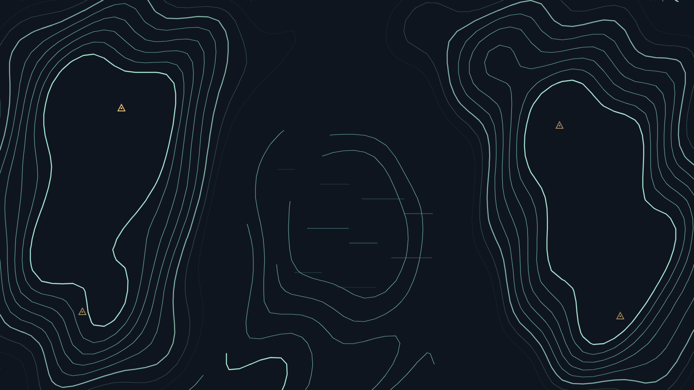

# Contour Map Night

The topographic survey after dark: pale teal contours on blue-black paper that draw themselves one height at a time. Its day twin is `contour-map`.

It is a dark theme and keeps the app dark. The panels are frosted over the scene so text stays readable. Animations stop if your system asks for reduced motion.

Install: `/plugin install contour-map-night --marketplace PerspicaciousGuy/ClaudeCodeThemes` (see the [repository README](../../README.md#install) for the desktop app and shell steps).
