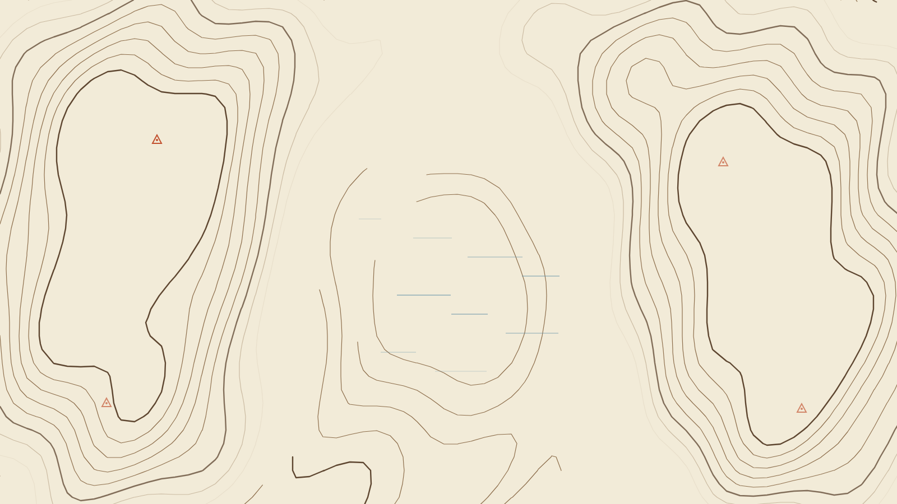

# Contour Map

A topographic survey on warm paper. The contours are computed from a made-up landscape and draw themselves one height at a time; survey marks pulse on the summits and the flat basin in the middle stays quiet under the chat. Its night twin is `contour-map-night`.

It is a light theme and keeps the app light. The panels are frosted over the scene so text stays readable. Animations stop if your system asks for reduced motion.

Install: `/plugin install contour-map --marketplace PerspicaciousGuy/ClaudeCodeThemes` (see the [repository README](../../README.md#install) for the desktop app and shell steps).
