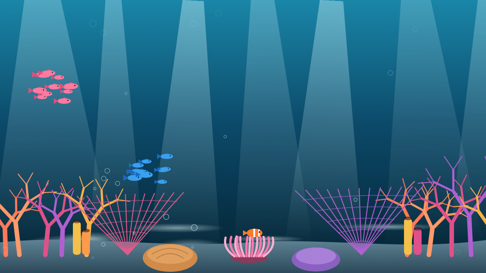

# Coral Reef

Rippling caustics of sunlight play over a colorful reef. Branching corals and sea fans sway, schools of bright fish turn together, a clownfish peeks out of its anemone, a turtle glides across and bubbles rise. Corals stay low at the sides and the middle is open water.

It is a dark theme and keeps the app dark. The panels are frosted over the scene so text stays readable. Animations stop if your system asks for reduced motion.

Install: `/plugin install coral-reef --marketplace PerspicaciousGuy/ClaudeCodeThemes` (see the [repository README](../../README.md#install) for the desktop app and shell steps).
