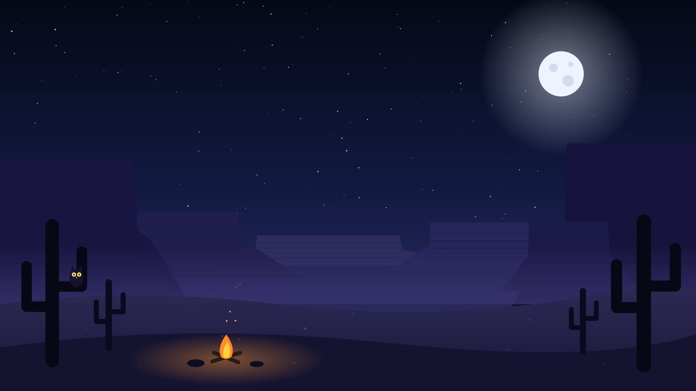

# Desert Night

The night twin of `desert-noon`. A cold moon and a field of stars hang over blue-violet mesas, saguaros stand in silhouette, a campfire at the lower left throws sparks into the dark, an owl blinks from a cactus and a shooting star crosses now and then.

It is a dark theme and keeps the app dark. The panels are frosted over the scene so text stays readable. Animations stop if your system asks for reduced motion.

Install: `/plugin install desert-night --marketplace PerspicaciousGuy/ClaudeCodeThemes` (see the [repository README](../../README.md#install) for the desktop app and shell steps).
