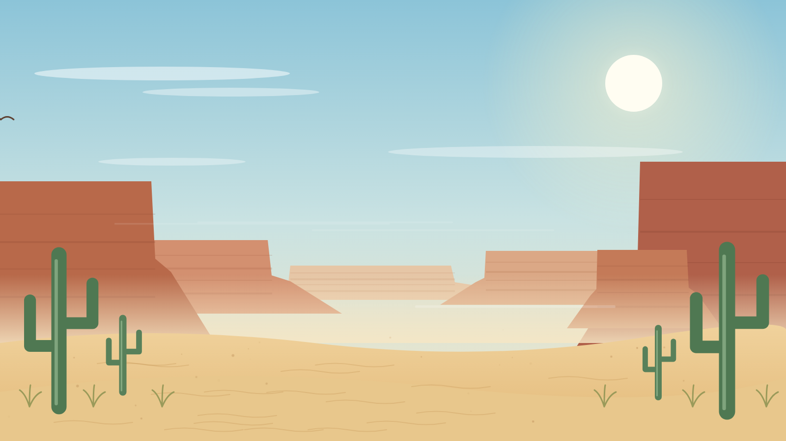

# Desert Noon

A bright desert at midday. Red mesas step back into haze, a pale sun glows over thin cloud, saguaros stand at the sides, the horizon shimmers with heat, dust blows over the sand and a tumbleweed rolls through. The middle stays low and quiet for the chat.

It is a light theme and keeps the app light. The panels are frosted over the scene so text stays readable. Animations stop if your system asks for reduced motion.

Install: `/plugin install desert-noon --marketplace PerspicaciousGuy/ClaudeCodeThemes` (see the [repository README](../../README.md#install) for the desktop app and shell steps).
