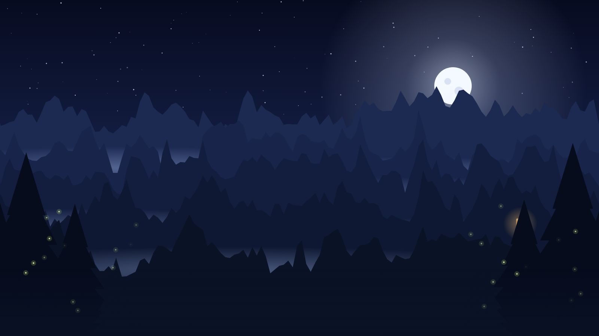

# Fog Valley Night

The night twin of `fog-valley`. A moon with slanting beams over deep-blue ridges, pale fog drifting between them, stars and the odd shooting star above, fireflies blinking among the pines and a small sky lantern rising at the right.

It is a dark theme and keeps the app dark. The panels are frosted over the scene so text stays readable. Animations stop if your system asks for reduced motion.

Install: `/plugin install fog-valley-night --marketplace PerspicaciousGuy/ClaudeCodeThemes` (see the [repository README](../../README.md#install) for the desktop app and shell steps).
