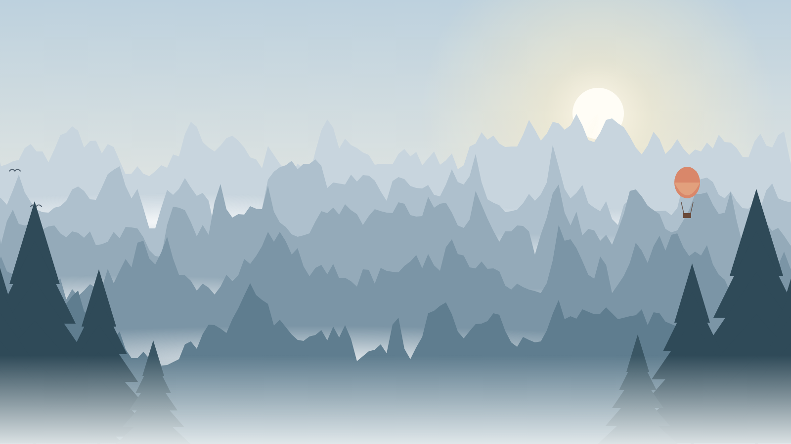

# Fog Valley

A misty mountain morning. Five blue ridges, each paler the farther it is, with bands of fog drifting between them, soft sun rays slanting down, a flock of birds crossing the valley and a small balloon far off. Pines frame the sides.

It is a light theme and keeps the app light. The panels are frosted over the scene so text stays readable. Animations stop if your system asks for reduced motion.

Install: `/plugin install fog-valley --marketplace PerspicaciousGuy/ClaudeCodeThemes` (see the [repository README](../../README.md#install) for the desktop app and shell steps).
