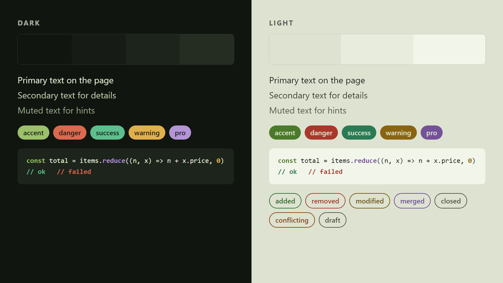

# Forest Floor

Soil-dark surfaces tinted green with a fern accent, and a pale lichen light mode. Success is a blue-green so it never reads as the accent. It follows the app's own light or dark mode.

It is a light and dark theme: it follows the app's own mode. It changes colors only: there is no backdrop, so the app keeps its own look otherwise.

Install: `/plugin install forest-floor --marketplace PerspicaciousGuy/ClaudeCodeThemes` (see the [repository README](../../README.md#install) for the desktop app and shell steps).
