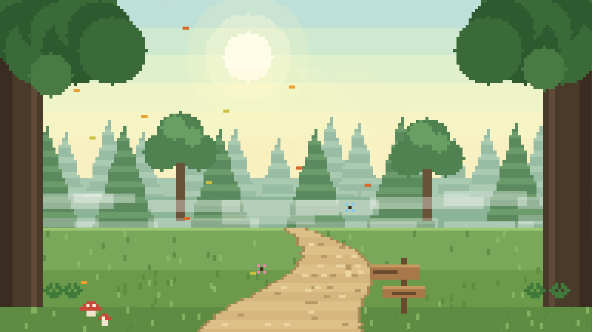

# Forest Trail

A dirt path winds into a forest on a bright morning. Sunbeams fall through layers of trees, mist drifts between them, butterflies flutter along the path and leaves fall. A signpost and a few mushrooms sit at the edge. The middle of the path stays soft for the chat.

It is a light theme and keeps the app light. The panels are frosted over the scene so text stays readable. Animations stop if your system asks for reduced motion.

Install: `/plugin install forest-trail --marketplace PerspicaciousGuy/ClaudeCodeThemes` (see the [repository README](../../README.md#install) for the desktop app and shell steps).
