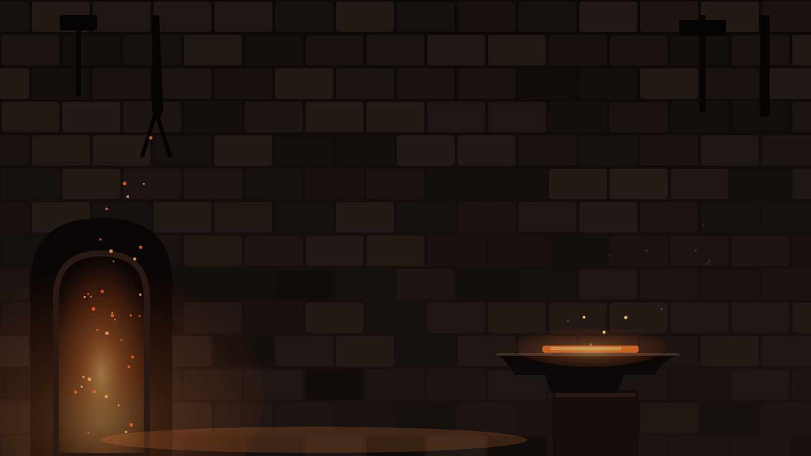

# Forge Glow

A blacksmith forge after dark. A furnace arch on the left breathes orange light across a stone wall hung with a hammer, tongs and a saw, a glowing bar lies on the anvil at the right, sparks burst off it in bursts and embers rise from the furnace into the dark.

It is a dark theme and keeps the app dark. The panels are frosted over the scene so text stays readable. Animations stop if your system asks for reduced motion.

Install: `/plugin install forge-glow --marketplace PerspicaciousGuy/ClaudeCodeThemes` (see the [repository README](../../README.md#install) for the desktop app and shell steps).
