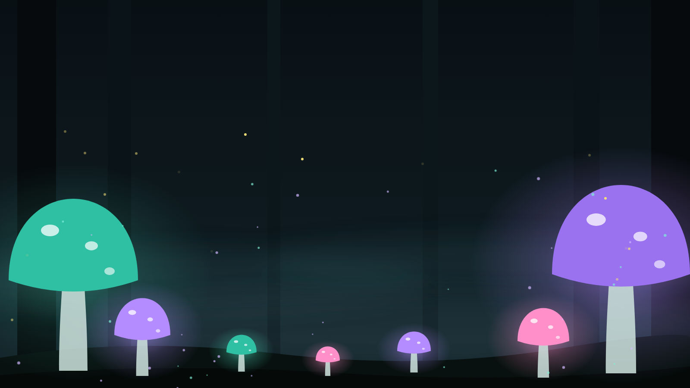

# Glow Grove

A forest at night lit by its mushrooms. Giant caps glow teal and violet at the edges of the screen, small ones in pink and teal line the floor, slow fog drifts between dark trunks, spores rise like sparks and fireflies blink on and off.

It is a dark theme and keeps the app dark. The panels are frosted over the scene so text stays readable. Animations stop if your system asks for reduced motion.

Install: `/plugin install glow-grove --marketplace PerspicaciousGuy/ClaudeCodeThemes` (see the [repository README](../../README.md#install) for the desktop app and shell steps).
