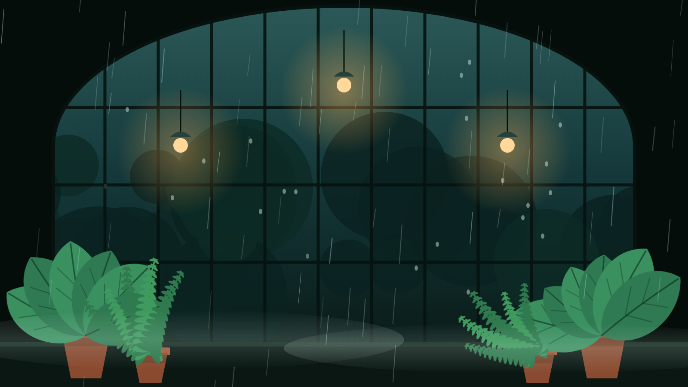

# Greenhouse Rain

Rain runs down the glass roof of a greenhouse at dusk, with drops sliding down the panes. Monstera leaves and ferns sway among the pots, warm lamps hang from the iron frame and mist drifts along the floor. The middle of the roof is open glass for the chat.

It is a dark theme and keeps the app dark. The panels are frosted over the scene so text stays readable. Animations stop if your system asks for reduced motion.

Install: `/plugin install greenhouse-rain --marketplace PerspicaciousGuy/ClaudeCodeThemes` (see the [repository README](../../README.md#install) for the desktop app and shell steps).
