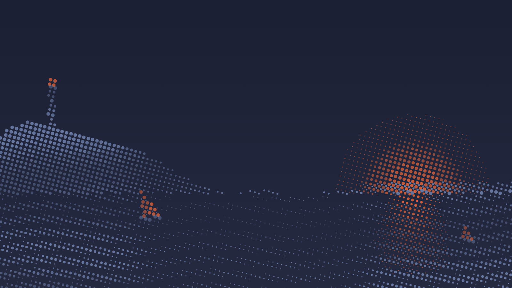

# Halftone Harbor Night

The same two-ink harbor print on night-blue stock: an ember sun and pale-blue water in slowly breathing dots, with the art kept to the sides. Its day twin is `halftone-harbor`.

It is a dark theme and keeps the app dark. The panels are frosted over the scene so text stays readable. Animations stop if your system asks for reduced motion.

Install: `/plugin install halftone-harbor-night --marketplace PerspicaciousGuy/ClaudeCodeThemes` (see the [repository README](../../README.md#install) for the desktop app and shell steps).
