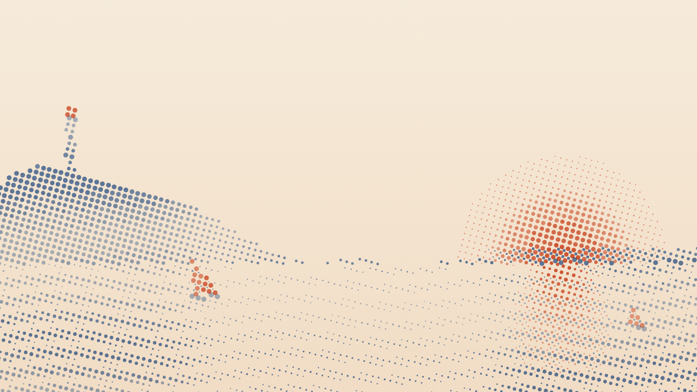

# Halftone Harbor

A two-ink print of a harbor at sunset. Every mark is a round dot and dot size is the only drawing tool: a coral sun and its wake, blue water, a headland with a lighthouse and two small boats. The dots breathe slowly. The art sits at the sides and rests under the chat. Its night twin is `halftone-harbor-night`.

It is a light theme and keeps the app light. The panels are frosted over the scene so text stays readable. Animations stop if your system asks for reduced motion.

Install: `/plugin install halftone-harbor --marketplace PerspicaciousGuy/ClaudeCodeThemes` (see the [repository README](../../README.md#install) for the desktop app and shell steps).
