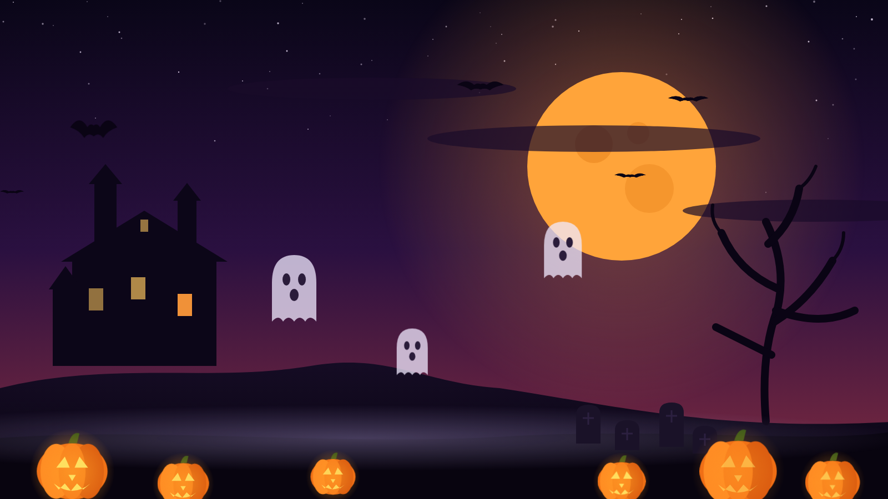

# Halloween Night

A huge orange moon over a haunted hill. A crooked manor has flickering windows, bats cross the sky, ghosts drift and bob, jack-o'-lanterns glow along the ground and fog rolls between the gravestones. A vector companion to haunted-manor.

It is a dark theme and keeps the app dark. The panels are frosted over the scene so text stays readable. Animations stop if your system asks for reduced motion.

Install: `/plugin install halloween-night --marketplace PerspicaciousGuy/ClaudeCodeThemes` (see the [repository README](../../README.md#install) for the desktop app and shell steps).
