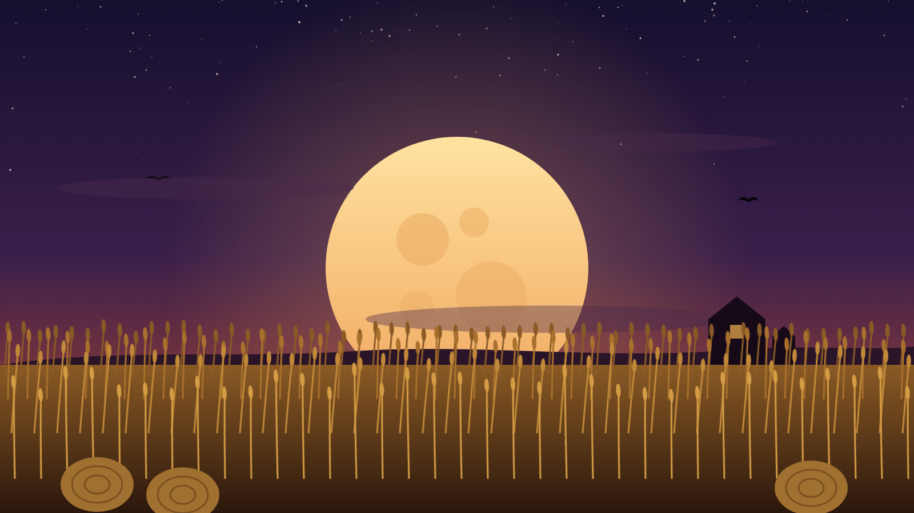

# Harvest Moon

A huge orange moon hangs low over a wheat field. The wheat sways in long waves, a barn and hay bales stand dark against the glow, crows cross the moon and thin clouds drift. The moon sits behind the middle of the chat.

It is a dark theme and keeps the app dark. The panels are frosted over the scene so text stays readable. Animations stop if your system asks for reduced motion.

Install: `/plugin install harvest-moon --marketplace PerspicaciousGuy/ClaudeCodeThemes` (see the [repository README](../../README.md#install) for the desktop app and shell steps).
