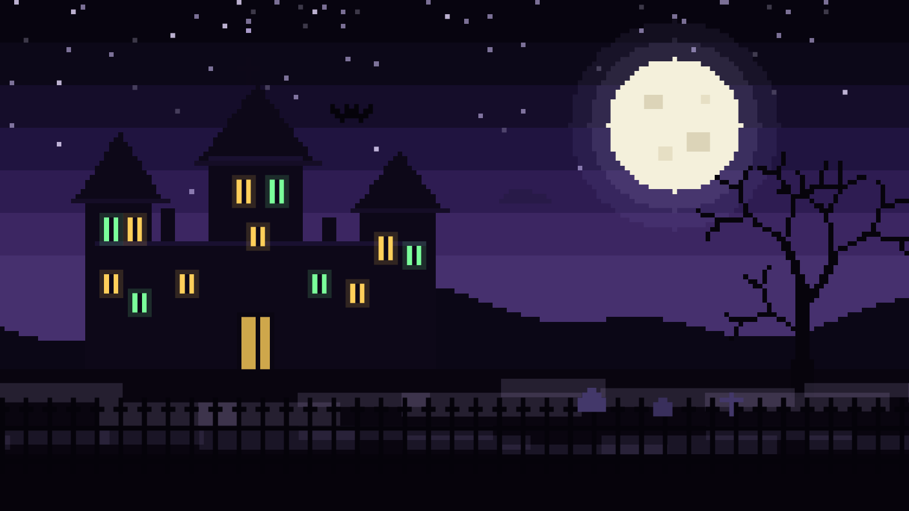

# Haunted Manor

A tall manor stands on a hill under a huge moon. Its windows flicker, bats cross the sky, fog drifts over the ground and a bare tree reaches over an iron fence with a few tombstones. The middle is open sky for the chat.

It is a dark theme and keeps the app dark. The panels are frosted over the scene so text stays readable. Animations stop if your system asks for reduced motion.

Install: `/plugin install haunted-manor --marketplace PerspicaciousGuy/ClaudeCodeThemes` (see the [repository README](../../README.md#install) for the desktop app and shell steps).
