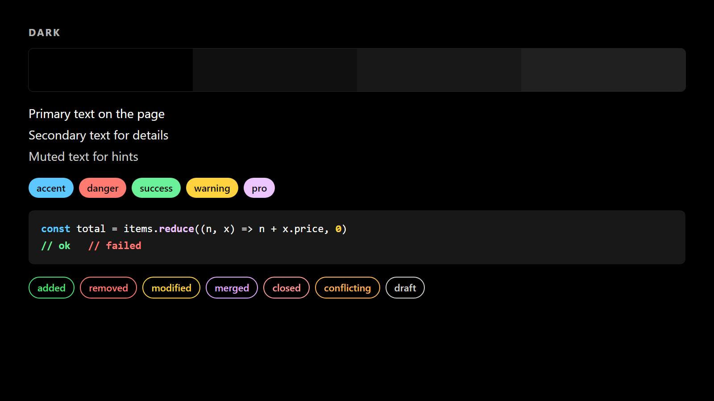

# High Contrast Dark

Pure black pages, white text and bright colors. Primary text is at 16:1 or better on every surface and even the muted text is above 10:1. The grays are neutral on purpose: a tint costs contrast. The theme sets `contrast: 'more'`, and the git colors (added, removed, modified, merged) are bright enough to read at a glance.

It is a dark theme and keeps the app dark. It changes colors only: there is no backdrop, so the app keeps its own look otherwise.

Its twin is `high-contrast-light`: with day and night on in the `theme-library` plugin, the library shows one by day and the other after dark.

Install: `/plugin install high-contrast-dark --marketplace PerspicaciousGuy/ClaudeCodeThemes` (see the [repository README](../../README.md#install) for the desktop app and shell steps).
