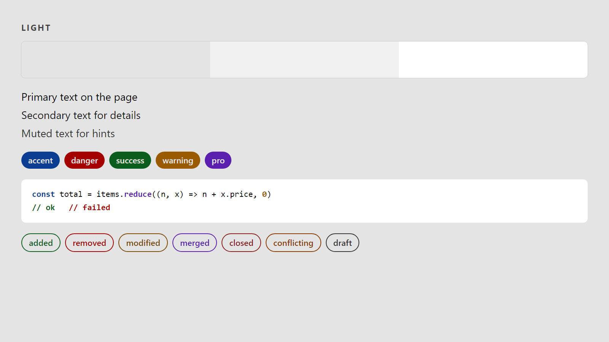

# High Contrast Light

White pages, black text and deep colors. Primary text is at 14:1 or better on every surface and even the muted text is near 10:1. The grays are neutral on purpose: a tint costs contrast. The theme sets `contrast: 'more'`, and the git colors are dark enough to read on white.

It is a light theme and keeps the app light. It changes colors only: there is no backdrop, so the app keeps its own look otherwise.

Its twin is `high-contrast-dark`: with day and night on in the `theme-library` plugin, the library shows one by day and the other after dark.

Install: `/plugin install high-contrast-light --marketplace PerspicaciousGuy/ClaudeCodeThemes` (see the [repository README](../../README.md#install) for the desktop app and shell steps).
