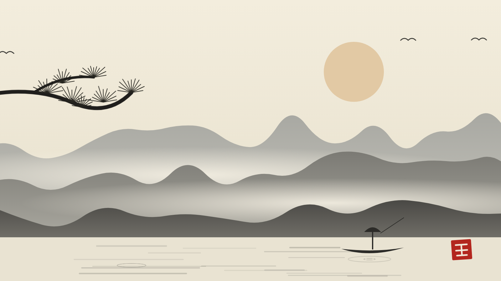

# Ink Wash

Mountains in grey ink washes fade into drifting mist on rice paper. A pine branch reaches in from the left, a lone boat rests on still water with rings spreading, birds cross and a red seal marks the corner.

It is a light theme and keeps the app light. The panels are frosted over the scene so text stays readable. Animations stop if your system asks for reduced motion.

Install: `/plugin install ink-wash --marketplace PerspicaciousGuy/ClaudeCodeThemes` (see the [repository README](../../README.md#install) for the desktop app and shell steps).
