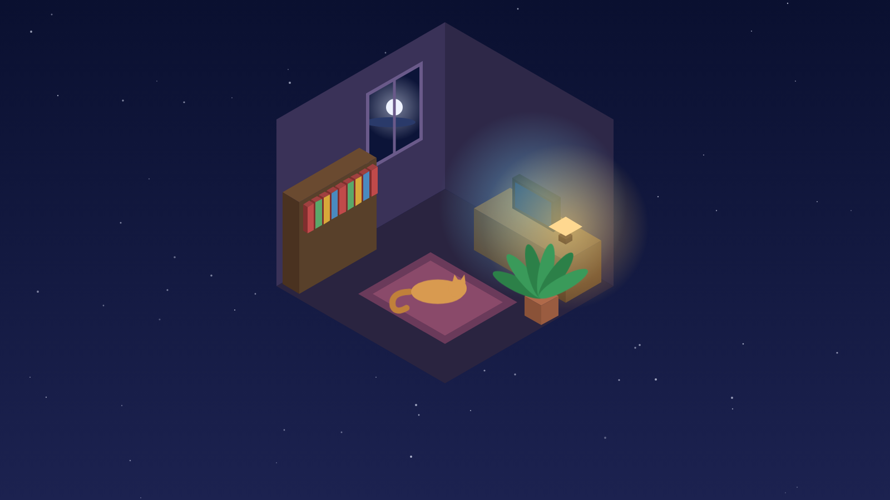

# Isometric Room

A cut-away isometric room at night. A monitor glows on the desk and a lamp warms its corner, a plant sways, books fill a shelf, the moon shines in the window and a cat sleeps on the rug with its tail twitching. The room sits in the middle of the screen.

It is a dark theme and keeps the app dark. The panels are frosted over the scene so text stays readable. Animations stop if your system asks for reduced motion.

Install: `/plugin install isometric-room --marketplace PerspicaciousGuy/ClaudeCodeThemes` (see the [repository README](../../README.md#install) for the desktop app and shell steps).
