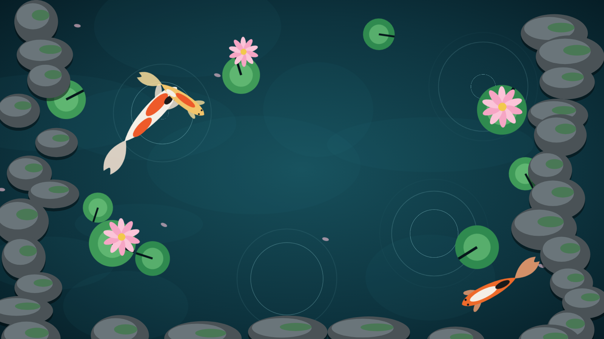

# Koi Pond

Looking straight down at a pond at dusk. Koi glide in slow loops, lily pads and pink flowers float on the dark water, ripples spread from time to time and a few petals drift by. Stones frame the edges and the middle is open water.

It is a dark theme and keeps the app dark. The panels are frosted over the scene so text stays readable. Animations stop if your system asks for reduced motion.

Install: `/plugin install koi-pond --marketplace PerspicaciousGuy/ClaudeCodeThemes` (see the [repository README](../../README.md#install) for the desktop app and shell steps).
