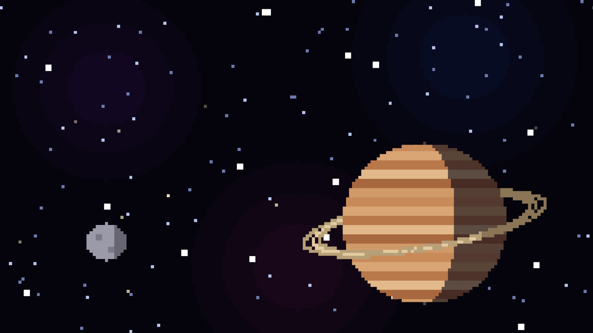

# Low Orbit

A pixel-art view of space. A ringed gas giant drifts slowly, three layers of stars scroll at different speeds, a small ship crosses and a shooting star passes now and then.

It is a dark theme and keeps the app dark. The panels are frosted over the scene so text stays readable. Animations stop if your system asks for reduced motion.

Install: `/plugin install low-orbit --marketplace PerspicaciousGuy/ClaudeCodeThemes` (see the [repository README](../../README.md#install) for the desktop app and shell steps).
