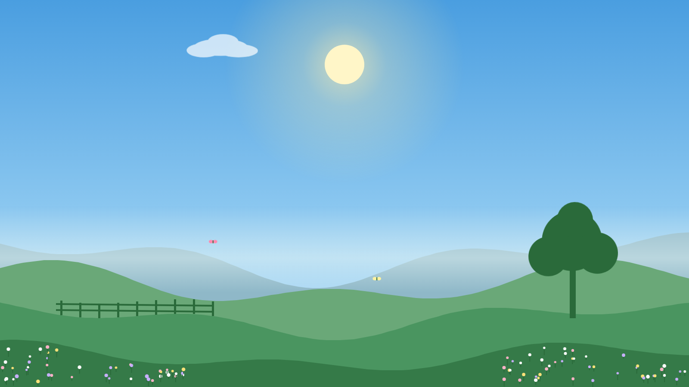

# Meadow Hours

A rolling meadow that follows your computer's clock. Night, dawn, day and dusk blend into one another; the sun and moon cross the sky, clouds drift, a lone tree sways, butterflies visit by day and fireflies fill the grass after dark. It redraws every ten minutes and keeps the app dark.

It is a dark theme and keeps the app dark. The panels are frosted over the scene so text stays readable. Animations stop if your system asks for reduced motion.

Install: `/plugin install meadow-hours --marketplace PerspicaciousGuy/ClaudeCodeThemes` (see the [repository README](../../README.md#install) for the desktop app and shell steps).
