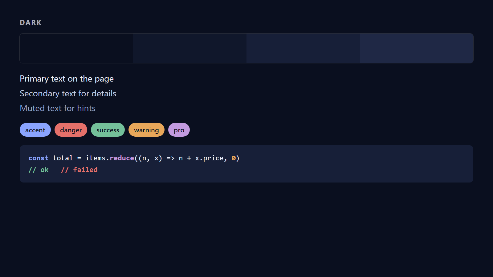

# Midnight Ink

Blue-black ink, pale text and a periwinkle accent, like writing at night. Its twin is `paperback`: with day and night on, the library shows paperback by day and this after dark.

It is a dark theme and keeps the app dark. It changes colors only: there is no backdrop, so the app keeps its own look otherwise.

Install: `/plugin install midnight-ink --marketplace PerspicaciousGuy/ClaudeCodeThemes` (see the [repository README](../../README.md#install) for the desktop app and shell steps).
