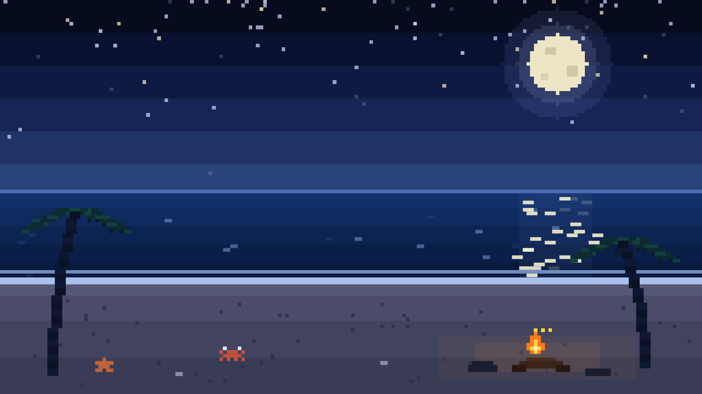

# Moonlit Shore

The night twin of `sunny-shore`. A pixel moon sheds a path of glitter over a dark sea, stars twinkle, slow foam rolls up bluish sand, palms stand in silhouette and a campfire at the right sends up sparks. A boat carries a lantern and a crab scuttles by.

It is a dark theme and keeps the app dark. The panels are frosted over the scene so text stays readable. Animations stop if your system asks for reduced motion.

Install: `/plugin install moonlit-shore --marketplace PerspicaciousGuy/ClaudeCodeThemes` (see the [repository README](../../README.md#install) for the desktop app and shell steps).
