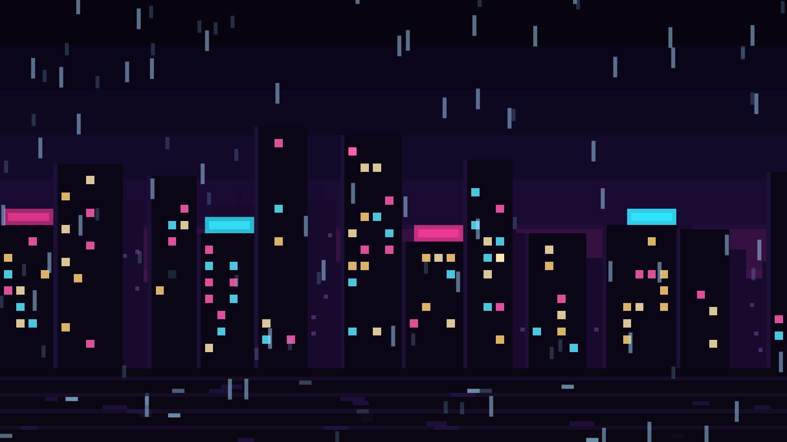

# Neon Rain

A pixel-art city in the rain at night. Towers with lit windows, neon signs that buzz and flicker, rain on a wet street and a car with its lights on passing through. The panels are dark violet.

It is a dark theme and keeps the app dark. The panels are frosted over the scene so text stays readable. Animations stop if your system asks for reduced motion.

Install: `/plugin install neon-rain --marketplace PerspicaciousGuy/ClaudeCodeThemes` (see the [repository README](../../README.md#install) for the desktop app and shell steps).
