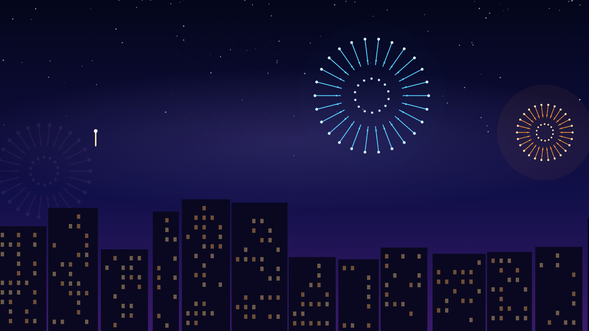

# New Year Fireworks

Rockets climb and burst over a city skyline in rings of colored sparks that drift down as they fade. Windows flicker, stars show through a thin haze of smoke and a new burst goes off every few seconds.

It is a dark theme and keeps the app dark. The panels are frosted over the scene so text stays readable. Animations stop if your system asks for reduced motion.

Install: `/plugin install new-year-fireworks --marketplace PerspicaciousGuy/ClaudeCodeThemes` (see the [repository README](../../README.md#install) for the desktop app and shell steps).
