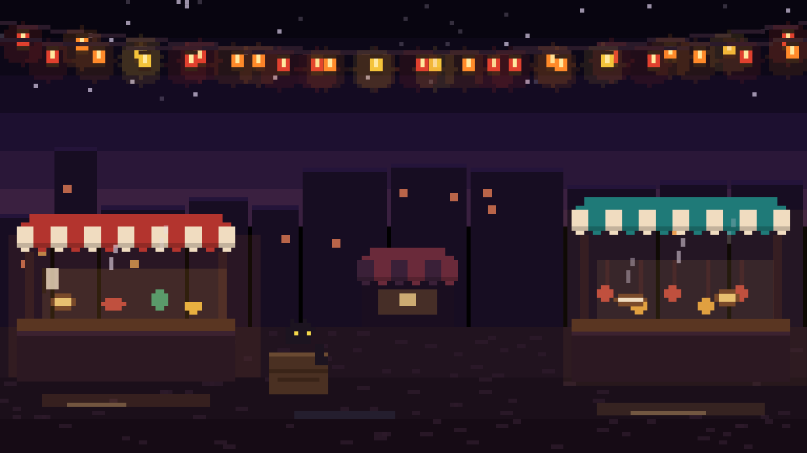

# Night Market

Two strings of paper lanterns swing over a cobbled lane. A stall on each side glows with steam rising from its bowls, a small dim stall sits far down the lane, and puddles carry the light. A cat sits on a crate and flicks its tail. The middle stays dark for the chat.

It is a dark theme and keeps the app dark. The panels are frosted over the scene so text stays readable. Animations stop if your system asks for reduced motion.

Install: `/plugin install night-market --marketplace PerspicaciousGuy/ClaudeCodeThemes` (see the [repository README](../../README.md#install) for the desktop app and shell steps).
