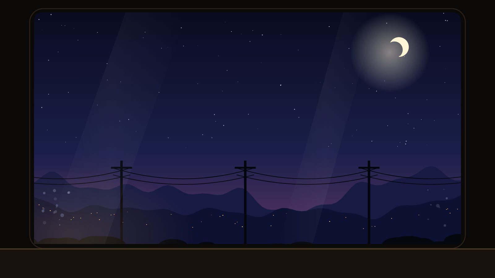

# Night Train

A night run seen from a carriage window. Far hills, the lights of small towns and telegraph poles with their sagging wires slide past at three speeds under a thin moon, behind a dark window frame with a warm reflection. Everything loops without a seam.

It is a dark theme and keeps the app dark. The panels are frosted over the scene so text stays readable. Animations stop if your system asks for reduced motion.

Install: `/plugin install night-train --marketplace PerspicaciousGuy/ClaudeCodeThemes` (see the [repository README](../../README.md#install) for the desktop app and shell steps).
