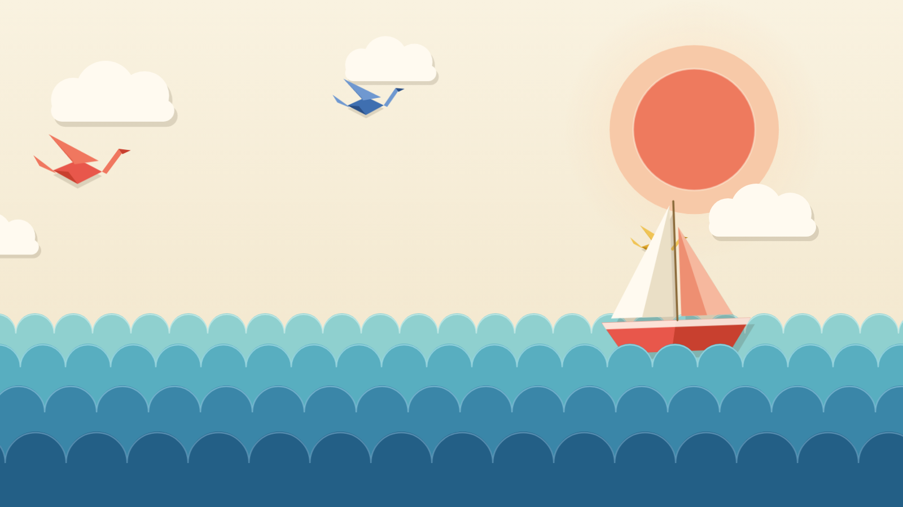

# Origami Bay

A bay made entirely of paper. Scalloped sheets of paper in four blues drift slowly like waves, each casting a soft shadow on the one below. A folded paper sailboat bobs on the water, three origami cranes in coral, blue and gold fly across the sky, and a paper sun glows over layered paper clouds. The boat and the sun sit toward the right so the middle stays clear for the chat.

It is a light theme and keeps the app light. The panels are frosted over the scene so text stays readable. Animations stop if your system asks for reduced motion.

Install: `/plugin install {ID} --marketplace PerspicaciousGuy/ClaudeCodeThemes` (see the [repository README](../../README.md#install) for the desktop app and shell steps).
