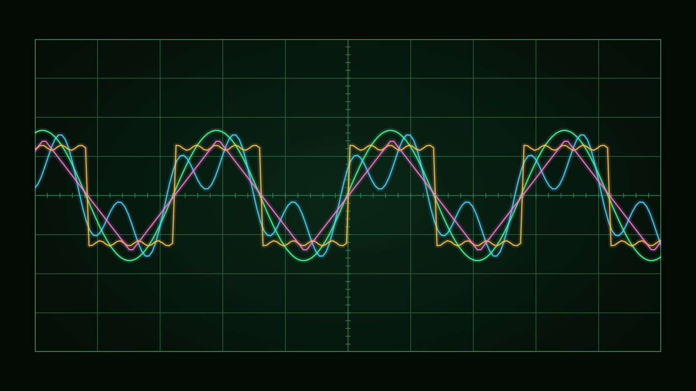

# Oscilloscope

A phosphor-green graticule on a dark screen. A sine, a two-tone mix, a square and a triangle wave scroll across in glowing lines while a cursor sweeps the display, with a slight flicker like an old tube.

It is a dark theme and keeps the app dark. The panels are frosted over the scene so text stays readable. Animations stop if your system asks for reduced motion.

Install: `/plugin install oscilloscope --marketplace PerspicaciousGuy/ClaudeCodeThemes` (see the [repository README](../../README.md#install) for the desktop app and shell steps).
