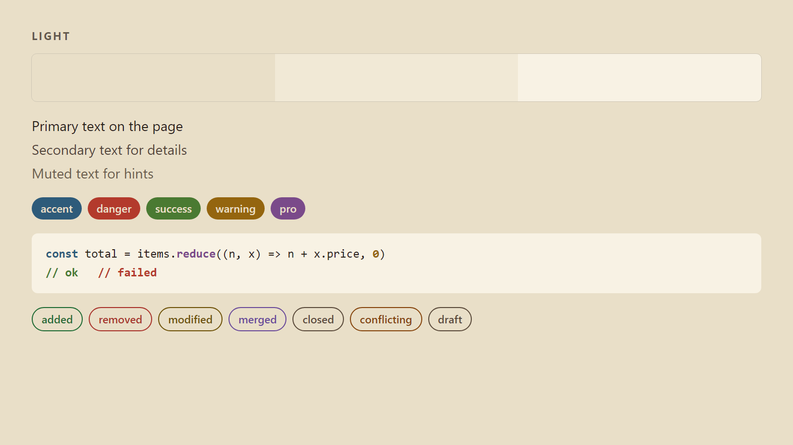

# Paperback

Cream pages, brown-black ink and an ink-blue accent, the way a much-read paperback looks. Its twin is `midnight-ink`, which turns the same idea into a night theme: with day and night on, the library shows one by day and the other after dark.

It is a light theme and keeps the app light. It changes colors only: there is no backdrop, so the app keeps its own look otherwise.

Install: `/plugin install paperback --marketplace PerspicaciousGuy/ClaudeCodeThemes` (see the [repository README](../../README.md#install) for the desktop app and shell steps).
